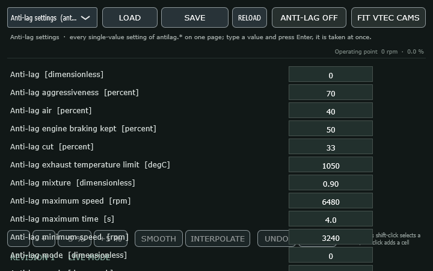

# Captured EngineLab audit evidence

Collected on 2026-11-16 for [the audit register](../audit.md). Raw output is retained; build labels printed by compilers are not findings. Synthetic boundary cases have the limits stated in the register.

## Physics/ECU/driveline

Original local artifact: `out/audit/physics_probe.log`.

```text
antilag_before_reset active=0 blockers=64
antilag_after_reset active=0 blockers=64
antilag_fresh active=1 blockers=0
backdrive slip_rpm=-100.924092831159 stick_fraction=0 engine_reaction_nm=100 engine_coupling_nm=100 reflected_inertia=0 wheel_torque_nm=-50 engine_rpm=900 wheel_rpm=1000.800067647 engine_power_w=9424.77796076938 wheel_power_w=-5240.17690038665 clutch_loss_w=1056.87462869528
aero_50_vs_120_kpa_max_speed_difference=0
infinite_knock_curve validation=accepted advance=-nan(ind) finite=0
infinite_knock_curve_yaml accepted=1 error=
descending_knock_curve validation=accepted
two_stroke_design cylinders=8 accepted=1 error=
two_stroke_design cylinders=9 accepted=0 error=Exhaust topology may contain at most 8 paths supported by audio
```

## Persistence and formats

Original local artifact: `out/audit/data-repro.log`.

```text
data-repro.cpp
Defining YAML_CPP_API for DLL import
base_valid=1
collision_paths_equal=1 first=A_B.json
first_save_error=none
second_save_error=none
first_file_now_contains=A*B
upper_ecu_name_error=none filename=My.ECU.json classified_as_calibration=1
reserved_name_error=none save_error=cannot replace CON.json
range_json_loaded=1 octane=130 warnings=1
range_yaml_loaded=0 error=range.yaml: Engine value out of range: octaneRating = 150, outside 70 to 130
oversized_schema_loaded=1 loaded_schema=9
fractional_valve_count_loaded=1 count=1
large_engine_valid=1
large_compact_bytes=812424 compact_decodes=1
large_save_error=none file_bytes=2617379
large_saved_file_loaded=0 error=large.json exceeds the 2 MiB limit
log_both_opened=1 first_log_row_preserved=0
```

## Scripting and Windows paths

Original local artifact: `out/audit/script-repro.log`.

```text
script-repro.cpp
windows_ansi_code_page=1252
accented_include_exists=1 compile_success=0
ES302: Cannot read engine script 'C:\Users\t3anc\OneDrive\Bureau\EngineLab\out\audit\script-fixtures\é.engine'.
accented_calibration_exists=1 watcher_error=The watched calibration file was not found.
script_bytes=242 parentheses=100
returned=1 diagnostics=0
small_nesting_exit=0
script_bytes=20042 parentheses=10000
large_nesting_exit=-1073741571
```

## UI, ECU state and export

Original local artifact: `out/audit/ui-audio-run-3.txt`.

```text
shift_conflict accepted=1 pause=1 throttle_idle=1 error=
reserved_save accepted=1 pause=1 error=
live_tuned_limit published=1 limit=3000
at_4000 live_limiter=1 export_default_limiter=0 config_limit=8700
tuner_store published=1
tuner_button 'LOAD' bounds=170 12 92 34
tuner_button 'SAVE' bounds=268 12 112 34
tuner_button 'RELOAD' bounds=386 12 58 34
tuner_button '-' bounds=12 382 38 28
tuner_button '+' bounds=54 382 38 28
tuner_button '-5 %' bounds=96 382 56 28
tuner_button '+5 %' bounds=156 382 56 28
tuner_button 'SMOOTH' bounds=224 382 80 28
tuner_button 'INTERPOLATE' bounds=308 382 108 28
tuner_button 'UNDO' bounds=428 382 64 28
tuner_button 'REDO' bounds=496 382 64 28
tuner_button 'FIT VTEC CAMS' bounds=584 12 124 34
tuner_button 'ANTI-LAG OFF' bounds=452 12 124 34
antilag_editor '0' bounds=480 110 140 26
antilag_editor '70' bounds=480 140 140 26
antilag_editor '40' bounds=480 170 140 26
antilag_editor '50' bounds=480 200 140 26
antilag_editor '33' bounds=480 230 140 26
antilag_editor '1050' bounds=480 260 140 26
antilag_editor '0.90' bounds=480 290 140 26
antilag_editor '6480' bounds=480 320 140 26
antilag_editor '4.0' bounds=480 350 140 26
antilag_editor '3240' bounds=480 380 140 26
antilag_editor '0' bounds=480 410 140 26
antilag_editor '25.0' bounds=480 440 140 26
antilag_editor_count=12 outside=1 overlapping_toolbar=3
failed_replace success=0 error=Could not replace out/audit/ui-audio-run-3\failed-replacement\scenario.json: The directory is not empty.
old_master_preserved=0 new_master_bytes=28844
tap duct=100
tap_export success=1 error=
old_tap_preserved=0 tap_bytes=19200
```

## Listening response integrity

Original local artifact: `out/audit/listening-repro.log`.

```text
{"case": "missing-pair", "exit": 0, "listeners": 1, "judgements": 1, "dropped_rows": 0, "per_pair_n": {"1": 1}, "sign_test_p": 1.0, "warning": false}
{"case": "duplicate-rows", "exit": 0, "listeners": 1, "judgements": 20, "dropped_rows": 0, "per_pair_n": {"1": 20}, "sign_test_p": 1.9073486328125e-06, "warning": false}
{"case": "unmatched-window", "exit": 0, "listeners": 1, "judgements": 1, "dropped_rows": 0, "per_pair_n": {"1": 1}, "sign_test_p": 1.0, "warning": true}
{"case": "1024-judgements", "exception": "OverflowError", "message": "(34, 'Result too large')"}
```

## 3-D route details

Original local artifact: `out/audit/scene-summary.txt`.

```text
2JZ-GTE-like 3.0 I6 Turbo {'ductClash': 4, 'selfClash': 0, 'engineClash': 0, 'tightBend': 5, 'stretched': 2}
{"issue": "ductClash", "duct": 18, "kind": 0, "path": 1, "element": 104, "other": 19, "value": 28.02, "authored_mm": 430.0, "drawn_mm": 440.944, "where_mm": [174.56, -2.47, -45.52]}
{"issue": "tightBend", "duct": 18, "kind": 0, "path": 1, "element": 104, "other": -1, "value": 0.52, "authored_mm": 430.0, "drawn_mm": 440.944, "where_mm": [165.53, -10.19, -49.81]}
{"issue": "stretched", "duct": 19, "kind": 0, "path": 1, "element": 105, "other": -1, "value": 1.28, "authored_mm": 430.0, "drawn_mm": 550.04, "where_mm": [153.94, 101.93, 134.38]}
LS3-like 6.2 Crossplane V8 {'ductClash': 0, 'selfClash': 2, 'engineClash': 0, 'tightBend': 14, 'stretched': 4}
{"issue": "selfClash", "duct": 27, "kind": 0, "path": 1, "element": 107, "other": -1, "value": 10.72, "authored_mm": 690.0, "drawn_mm": 690.202, "where_mm": [333.36, 18.55, 174.1]}
{"issue": "tightBend", "duct": 30, "kind": 0, "path": 1, "element": 212, "other": -1, "value": 0.53, "authored_mm": 140.0, "drawn_mm": 484.655, "where_mm": [-49.01, -27.74, 870.15]}
{"issue": "stretched", "duct": 30, "kind": 0, "path": 1, "element": 212, "other": -1, "value": 3.46, "authored_mm": 140.0, "drawn_mm": 484.655, "where_mm": [-191.33, -17.98, 942.09]}
Hayabusa-like 1.3 I4 {'ductClash': 0, 'selfClash': 1, 'engineClash': 0, 'tightBend': 4, 'stretched': 0}
{"issue": "selfClash", "duct": 17, "kind": 0, "path": 1, "element": 300, "other": -1, "value": 21.35, "authored_mm": 256.2, "drawn_mm": 255.568, "where_mm": [183.72, -42.79, 317.04]}
{"issue": "tightBend", "duct": 17, "kind": 0, "path": 1, "element": 300, "other": -1, "value": 0.61, "authored_mm": 256.2, "drawn_mm": 255.568, "where_mm": [239.37, -57.08, 330.69]}
Yamaha CP2 MT-07-like 689 Twin {'ductClash': 0, 'selfClash': 0, 'engineClash': 0, 'tightBend': 2, 'stretched': 0}
{"issue": "tightBend", "duct": 0, "kind": 2, "path": 1, "element": 1, "other": -1, "value": 0.61, "authored_mm": 120.0, "drawn_mm": 119.009, "where_mm": [-94.05, 250.78, -50.0]}
Yamaha CP3 MT-09-like 890 Triple {'ductClash': 0, 'selfClash': 0, 'engineClash': 0, 'tightBend': 3, 'stretched': 0}
{"issue": "tightBend", "duct": 0, "kind": 2, "path": 1, "element": 1, "other": -1, "value": 0.82, "authored_mm": 180.0, "drawn_mm": 179.17, "where_mm": [-113.65, 255.28, -97.5]}
Yamaha CP4 MT-10-like 998 Crossplane I4 {'ductClash': 0, 'selfClash': 1, 'engineClash': 0, 'tightBend': 6, 'stretched': 0}
{"issue": "selfClash", "duct": 17, "kind": 0, "path": 1, "element": 300, "other": -1, "value": 36.97, "authored_mm": 256.2, "drawn_mm": 255.696, "where_mm": [180.32, -44.67, 317.06]}
{"issue": "tightBend", "duct": 17, "kind": 0, "path": 1, "element": 300, "other": -1, "value": 0.5, "authored_mm": 256.2, "drawn_mm": 255.696, "where_mm": [240.33, -47.13, 328.14]}
MT-07-like 689 Twin Full System {'ductClash': 0, 'selfClash': 0, 'engineClash': 0, 'tightBend': 2, 'stretched': 0}
{"issue": "tightBend", "duct": 0, "kind": 2, "path": 1, "element": 1, "other": -1, "value": 0.61, "authored_mm": 120.0, "drawn_mm": 119.009, "where_mm": [-94.05, 250.78, -50.0]}
Audio Physics Lab 689 Twin {'ductClash': 0, 'selfClash': 0, 'engineClash': 0, 'tightBend': 2, 'stretched': 0}
{"issue": "tightBend", "duct": 0, "kind": 2, "path": 1, "element": 1, "other": -1, "value": 0.61, "authored_mm": 120.0, "drawn_mm": 119.009, "where_mm": [-94.05, 250.78, -50.0]}
Yamaha RD350LC-like 347 Two-Stroke Twin {'ductClash': 0, 'selfClash': 0, 'engineClash': 0, 'tightBend': 1, 'stretched': 0}
{"issue": "tightBend", "duct": 22, "kind": 0, "path": 2, "element": 201, "other": -1, "value": 0.75, "authored_mm": 260.0, "drawn_mm": 259.507, "where_mm": [165.46, 69.49, 3.7]}
13B Renesis-like 2-Rotor {'ductClash': 0, 'selfClash': 0, 'engineClash': 0, 'tightBend': 7, 'stretched': 0}
{"issue": "tightBend", "duct": 11, "kind": 0, "path": 1, "element": 101, "other": -1, "value": 0.95, "authored_mm": 450.0, "drawn_mm": 449.46, "where_mm": [212.37, 107.33, 65.85]}
```

## Fresh current-source A/B harness stdout

Original local artifact: `out/audit/audio-ab-current.stdout.txt`.

```text
Loaded IR: .\assets\ir\exhaust_default.wav (33705 samples @ 44100 Hz)
Loaded 18 catalogue engines from .\engines
Voicing: convolution=0.45 (default), exhaustPreset=street (default)

=== K20A-like 2.0 I4 VTEC  (idle 950, redline 8600 rpm) ===
```

## Fresh current-source A/B harness exit

Original local artifact: `out/audit/audio-ab-current.exit.txt`.

```text
-1073740791
```

## Caught causal A/B harness exception

Original local artifact: `out/audit/audio-ab-caught.stderr.txt`.

```text
AUDIT_CAUGHT_EXCEPTION: A/B harness exhausted its thermoacoustic queue
```

## Caught causal A/B harness exit

Original local artifact: `out/audit/audio-ab-caught.exit.txt`.

```text
73
```

## Tested existing binaries

| Instrument | SHA-256 |
|---|---|
| `EngineLabSceneExport.exe` | `F136E872C85CB840B561F60FB956C2025CA1E92F95D3F5673CDCFE832440F4D8` |
| `EngineLabAudioAbHarness.exe` | `92F3E856878C1110C8C7A4475AA979C70DBDA71E57403963D86C6160AE1433FA` |
| `EngineLabAbClipRenderer.exe` | `AA955D1D5A864F5BAA69E08136AE5625AE54BF8611540D156CFCD5F7373AB4AA` |
| `EngineLabDynoSweepHarness.exe` | `1441CA8F7DEBAAAD8AF2D97C7C6002AE8D90CB0485E3ED91ABE5C5D6B0453AC4` |

The AudioAb harness was also compiled from its current owning source; the uncaught and caught results above distinguish the observed fast-fail from the captured C++ exception. SceneExport was the existing binary; no rendering source was dirty, and its source/library/executable timestamp ordering was checked. Timestamps alone are not a cryptographic source-to-binary equivalence proof.

## Reference corpus and required-reference preflight

Command executed from the repository root:

```powershell
& out/build/windows-vs2022/tools/Release/EngineLabAbClipRenderer.exe --output out/audit/reference-preflight --engines '2JZ,LS3,Hayabusa,Big Twin,EJ25' --reference-manifest references/real-engine-audio/manifest.json --require-references
```

All five files passed preflight: 2JZ 48,000 Hz / 35.4688 s; LS3 44,100 Hz / 8.53002 s; Hayabusa 44,100 Hz / 22.4878 s; Big Twin 44,100 Hz mono / 47.0101 s; EJ25 44,100 Hz / 35.2073 s. The 44.1 kHz assets were resampled to 48 kHz. Each of the ten engine/segment requests was rejected for the absent `segment_windows` entry. Final output:

```text
Required reference corpus is incomplete; no listening clips were rendered.
exit=2
```

Manifest inspection found ten references, all `rpm.status=unknown` and all zero `segment_windows`: 2JZ, LS3, Hayabusa, Big Twin, EJ25, K20, Merlin, Aircooled, CP3, Radial. Only Hayabusa, Merlin and CP3 are labelled `exact-platform`.

## Manufacturer check failure masking

```text
EngineLabDynoSweepHarness --reference-file out/audit/does-not-exist.csv --report-only
invalid or empty manufacturer reference file: out/audit/does-not-exist.csv
report_only_exit=0

EngineLabDynoSweepHarness --reference-file out/audit/does-not-exist.csv
invalid or empty manufacturer reference file: out/audit/does-not-exist.csv
enforced_exit=1
```

## Actual component software rendering

The real `EcuTunerComponent`, existing 2JZ calibration, Anti-lag page, 720 × 450 content size. This is an automated component rendering without live app control. Exact control bounds appear in the UI raw output above.



