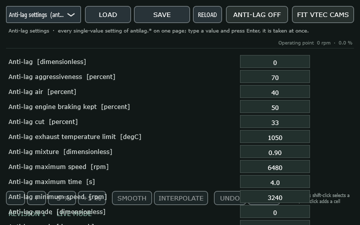

# EngineLab audit register

Audit of **2026-11-16**, prepared for owner review. **90 findings** are recorded below: reproduced defects, source-proven defects, explicit product/validation limits, and three previously measured acoustic/thermal discrepancies. These categories are not all “new bugs”. No implementation, corrective design or remedy is proposed.

**Systematic review completed:** **553/553 tracked files**, including **174,336 text lines**, were reviewed; binary resources received the stated integrity/metadata checks. [The coverage ledger](audit-coverage.md) identifies every reviewed path and byte hash. File review is distinct from exercising every possible input, device, operating state or platform. [Continuation evidence](audit-evidence/continuation.md), [exact reproduction sources](audit-evidence/continuation-reproductions.md) and [detailed subreview notes](audit-evidence/review-notes.md) preserve the additional proof and refutations.

## Examined state and evidence rules

- Working directory: `C:\Users\t3anc\OneDrive\Bureau\EngineLab`.
- Branch: `exp/port-film-tau`; base commit `c368930c32ddf2556b6b28eb19fbcc6be55728e7` (`reference: Suzuki TS125 exhausts of Jones & Brown (NASA TM-84061)`). `CMakeLists.txt` reports version 0.9.1; this working tree includes work beyond a clean release checkout. These findings must not all be attributed to the released 0.9.1 binary.
- Nine tracked files were already modified at the start: `CHANGELOG.md`, `MainComponent.hpp/.cpp`, `EcuCalibration.hpp/.cpp`, `CalibrationTests.cpp`, `SavedEngines.hpp/.cpp`, and `SavedEngineTests.cpp`. The existing `essai-sortie/` and `sources-gratuites/` directories were retained. **This audit changed no application source, preset, build configuration or existing local edit.** Scratch probes and generated test fixtures are under `out/audit/` and `out/audit2/`; durable results are in this report and `docs/audit-evidence/`.
- Repository instructions were read before investigation. The report is English in accordance with `.claude/CLAUDE.md`; the owner's request explicitly authorizes this broad audit beyond the current feature priority.
- **Reproduced** means the named probe executed and the quoted result was observed. **Source-proven** means a complete current ownership/control/data path establishes the defect, without claiming a measured crash or symptom frequency. **Existing measured discrepancy** means a current journal record was inspected but its long experiment was not rerun.
- Priority is for owner review: **P1** significant correctness, data-integrity, process-ending or central sound/measurement issue; **P2** material functional or validation limitation; **P3** narrower ergonomics, quality or documentation issue. This is a triage judgement, not an implementation order or an approved change list.

## Coverage and practical limits

All first-party tracked files at continuation start are in the hashed ledger: source, tests, tools, engine/part/voicing data, build/CI/packaging files, documentation and resources. Generated builds, fetched third-party implementations, local measurement exports and audit artifacts are explicitly outside that 553-file denominator; dependency/asset/packaging contracts were checked separately. No upstream JUCE-wide audit is claimed.

| Area | Evidence gathered | Practical limit |
|---|---|---|
| Physics / gas / ECU / drivetrain | Full source review, component/extracted-source witnesses, all registered Windows tests | No exhaustive convergence/thermal/vehicle campaign |
| Realism / reference data | Fresh 24 catalogue rated points PASS; 22 generated-design points 20 PASS / 2 FAIL with stable holds | Derived unspecified design inputs; no independent complete real-engine reconstruction |
| Creation / persistence / scripting | Fresh valid/invalid decodes, save/read, filename/size/Unicode/stack witnesses | No exhaustive fuzzing, disk-full/crash recovery or exploit claim |
| Runtime / concurrency | Complete ownership review, datalog witness, source-proven races | No race-detector run or measured race incidence |
| Interface / ergonomics | Actual JUCE component images/bounds, clock/model/keyboard paths, hardened current inspector | Four integrated/focus sequences remain source-only; no live desktop tour, screen-reader/DPI campaign |
| 3-D | Fresh route export of all 18 engines, independent length sums, scalar field binding/ratios | No live OpenGL/material/camera tour |
| Audio / export | Short real renderer/exporter probes, actual filter/source headers, full AudioRender test | No new blind listening, recording comparison or hardware-device campaign |
| Real-time | All 18 short 60%-redline runtime+48kHz audio+gas-view points attempted; 17 valid; Merlin paced control | Merlin accelerated point invalid; no complete-catalogue capacity ranking, GPU/device or full-rpm-range claim |
| Build / distribution | Full authoritative Windows Release build, 108 tests each passed at least once, staged 71-file install, fresh Linux configure/build attempt | Initial Windows suite had 2 timeouts; Linux App build blocked, only 4 independent Linux tests passed |

The full Windows build passed using the normal incremental build command. Initial `ctest -j4` passed 106/108 entries, with AudioRender and LoadedAccelerationCatalogDfcoResume timing out. Both passed when rerun alone sequentially (159.74s/166.15s). The first command therefore remains an unsuccessful parallel invocation; all 108 tests nevertheless have passing executions. No compilation/harness ran concurrently with those runs. PLAT-01 records the fresh GCC 13.3 standard-preset build failure; [Linux evidence](audit-evidence/linux.md) distinguishes it from the four passing independent tests.

The application was launched during the first pass, when capture failed and a physical Escape stopped computer use. The owner's continuation authorized further analysis. A fresh staged-app attempt again exposed a window but failed activation, then a refreshed capture retry failed with `FrameArrived timed out`. No further UI input followed; only the scratch-staged process was closed. These are automation limits, not proof of a startup defect. Images are software captures of real components.

Original physics/data/script/UI-audio witnesses were recompiled and repeated against the freshly built Windows libraries/objects; their results remain confirmed. The A/B harness abort and all 18 scene routes were also repeated with the fresh authoritative tools. Original first-pass provenance remains identified where useful; continuation output supersedes its existing-binary limitation.

## Finding index

Each item describes the trigger, evidence, impact and uncertainty. The three K entries are separately identified existing measurements. The complete [captured evidence](audit-evidence/evidence.md) and [probe sources/build scripts](audit-evidence/reproductions.md) preserve the witnesses without changing production code. The [continuation evidence](audit-evidence/continuation.md) and [additional sources](audit-evidence/continuation-reproductions.md) cover all added findings.

Status: `fixed <commit>` on branch `fix/audit-2026-11-16` (lots 0-4); `owner decision` waits for the owner; `open` is in lots 5-8, not started.

| ID | Priority | Finding | Status |
|---|---|---|---|
| [PH-01](#ph-01) | P1 | The transmission creates power when the wheels drive the engine | fixed a3c79b4 |
| [PH-02](#ph-02) | P1 | A malformed knock-limit curve is accepted and can produce NaN ignition commands | fixed 2f1fe31 |
| [PH-03](#ph-03) | P2 | ECU reset leaves anti-lag timeout and feedback state from the preceding run | fixed 119deb7 |
| [PH-04](#ph-04) | P2 | Road aerodynamic drag ignores the configured atmosphere | fixed a3c79b4 |
| [PH-05](#ph-05) | P2 | Construction limits contradict the advertised range and the unlimited-build criterion | owner decision |
| [PH-06](#ph-06) | P2 | Live ambient-temperature edits leave retained thermal boundaries on the old atmosphere | fixed a3c79b4 |
| [DR-01](#dr-01) | P1 | A new engine design can overwrite another saved engine through a filename collision | fixed b144b8a |
| [DR-02](#dr-02) | P2 | A successful save can produce a file the application refuses to read | fixed b144b8a |
| [DR-03](#dr-03) | P1 | A small syntactically valid engine script can overflow the stack | fixed 812cd52 |
| [DR-04](#dr-04) | P1 | Live gearbox edits write a value that the simulation thread reads without synchronization | fixed e05f68f |
| [DR-05](#dr-05) | P2 | UTF-8 paths fail in script includes and ECU hot reload on standard Windows code page 1252 | fixed c44352e |
| [DR-06](#dr-06) | P2 | An accepted saved-engine name can be reclassified as an ECU calibration | fixed b144b8a |
| [DR-07](#dr-07) | P2 | JSON and YAML imports disagree about repairing the same out-of-range value | fixed 60f83de |
| [DR-08](#dr-08) | P2 | JSON integer fields silently truncate fractions and wrap oversized values | fixed 60f83de |
| [DR-09](#dr-09) | P2 | Starting two logs or pass-by recordings within the same second reuses the same output file | fixed 8e26a01 |
| [DR-10](#dr-10) | P3 | Windows reserved device names pass saved-engine name validation | fixed b144b8a |
| [UA-01](#ua-01) | P1 | Audio Workshop exports discard the running engine's ECU tuning | fixed 0d46f4e |
| [UA-02](#ua-02) | P2 | Anti-lag settings overlap the toolbar and leave the tuner at its allowed minimum size | open |
| [UA-03](#ua-03) | P2 | Distinct accepted Shift bindings can trigger the same event | open |
| [UA-04](#ua-04) | P2 | The key-binding editor accepts Ctrl+S for an action that can never receive it | open |
| [UA-05](#ua-05) | P2 | A failed offline overwrite can already have destroyed the old render | fixed ea253b4 |
| [UA-06](#ua-06) | P2 | A diagnostic export overwrites an existing tap despite overwrite being disabled | fixed ea253b4 |
| [UA-07](#ua-07) | P2 | Pointer-only controls block ordinary keyboard access to several features | open |
| [UA-08](#ua-08) | P1 | The A/B audio measurement harness aborts on its first engine | fixed 61095e2 |
| [R01](#r01) | P2 | Catalogue pipes still intersect other pipes or themselves | open |
| [R02](#r02) | P2 | Some drawn pipes are substantially longer than the authored physics geometry | open |
| [R03](#r03) | P3 | The routing checker reports 46 bends below its minimum bend-radius criterion | open |
| [V01](#v01) | P1 | An A/B response copied twenty times becomes twenty independent votes | fixed 78a71f7 |
| [V02](#v02) | P2 | Entirely missing answers are accepted as a complete response set | fixed 78a71f7 |
| [V03](#v03) | P2 | Known condition-mismatched recordings still enter global realism statistics | fixed 78a71f7 |
| [V04](#v04) | P2 | Listening reports crash at 1,024 judgements | fixed 78a71f7 |
| [V05](#v05) | P2 | The shipped recording manifest cannot run its documented required-reference comparison | owner decision |
| [V06](#v06) | P2 | None of the ten field-recording references documents engine speed | owner decision |
| [V07](#v07) | P2 | Designed-engine manufacturer checks never fail CI for a performance miss | owner decision |
| [V08](#v08) | P3 | Documentation describes obsolete validation, format and live-edit behavior | open |
| [K01](#k01) | P1 | The TS125 audio path loses roughly 7–9 dB at the low-frequency port source | owner decision |
| [K02](#k02) | P2 | The current exhaust port thermal model has no separate cooled-head port region | owner decision |
| [K03](#k03) | P2 | Significant ACME spectral errors remain after the cone-gain defect was removed | owner decision |
| [PG-01](#pg-01) | P1 | Exhaust boundary history is shorter than its fixed reconstruction delay | fixed a97ccdf |
| [PG-02](#pg-02) | P2 | Wet nitrous fuel is omitted from fuel consumption | fixed c3de893 |
| [PG-04](#pg-04) | P2 | The internal reordered-duct test executes one ascending chunk | fixed 58816e5 |
| [PG-05](#pg-05) | P2 | Remeshing a tapered duct does not preserve its inventory | fixed e6a4473 |
| [PG-06](#pg-06) | P2 | Overrun backfires re-enable fuel during an overboost cut | fixed 894ad14 |
| [PG-07](#pg-07) | P1 | A YAML alias cycle in embedded ECU data recursively exhausts the stack | fixed 60510df |
| [PG-08](#pg-08) | P2 | Scripted listener distance keeps millimetres in a metre field | fixed 6b38967 |
| [A2-01](#a2-01) | P2 | Cancelling a stem export leaves a Windows-locked partial and blocks the next export | fixed ea253b4 |
| [A2-02](#a2-02) | P2 | Forced-induction sound continues while paused | fixed a1b21e1 |
| [A2-03](#a2-03) | P2 | Closing a valve preserves an undamped offset in the reflection filter | fixed 3a29333 |
| [A2-04](#a2-04) | P2 | The jet-noise renderer bypasses its own subsonic velocity cap | fixed 0ebf190 |
| [A2-05](#a2-05) | P2 | Intake tapered runner propagation gains power between unequal endpoint admittances | fixed 9244b71 |
| [A2-06](#a2-06) | P2 | Authored-component pressure taps address only the first taper section | fixed 4ef50da |
| [A2-07](#a2-07) | P2 | Live replacement reads the network owner while the audio thread swaps it | fixed e05f68f |
| [A2-08](#a2-08) | P2 | Complementary exhaust bands are summed with different source times | fixed 60c4ad5 (owner A/B) |
| [RT2-01](#rt2-01) | P2 | Changing engine during a datalog makes the recorded time jump backwards | fixed 8e26a01 |
| [T2-01](#t2-01) | P2 | The maximum-mix quality test bypasses the boosted mixer settings it claims to validate | fixed aaf498f |
| [TL2-01](#tl2-01) | P2 | Cyclic variability silently discards the zero/negative-work cycles that create roughness | fixed 00f307b |
| [TL2-02](#tl2-02) | P2 | Every drive-scenario CSV row contains five unnamed fields | fixed d7b92e5 |
| [TL2-03](#tl2-03) | P2 | A manufacturer-reference check reports success after selecting no engines or points | fixed 265c219 |
| [TL2-04](#tl2-04) | P2 | The purported X-only exhaust control also removes 1.21 metres from each LS3 bank | fixed d8c943b |
| [APP-01](#app-01) | P1 | An exhaust designer opened before Save As can restore the original engine identity | fixed f2f6b64 |
| [APP-02](#app-02) | P2 | The successful exhaust apply erases the baseline before calculating its cost warning | fixed 843166a |
| [APP-03](#app-03) | P2 | An open Audio Workshop exports stale live-edited engine geometry | fixed 0d46f4e |
| [APP-04](#app-04) | P2 | Engine switching leaves Audio Workshop physics controls on the preceding engine | fixed 0d46f4e |
| [APP-05](#app-05) | P2 | Escape in a vehicle numeric field does not cancel its pending value | fixed 843166a |
| [APP-06](#app-06) | P2 | Build can use the previous designer state during its 250 ms text debounce | fixed 843166a |
| [APP-07](#app-07) | P3 | VTEC adds a telemetry row without increasing its layout or content height | open |
| [APP-08](#app-08) | P2 | Strobe playback keeps turbo and gearbox shafts moving while paused | open |
| [APP-09](#app-09) | P2 | The minimum-width toolbar places A/B, Log and Exhaust on top of one another | open |
| [APP-10](#app-10) | P2 | Primary numerical readouts are clipped at the supported main-window minimum | open |
| [APP-11](#app-11) | P3 | The Pass-by minimum height removes the microphone level control | open |
| [APP-12](#app-12) | P2 | A last-ratio click can read beyond the resized inspector values | fixed b0f31f3 |
| [APP-13](#app-13) | P3 | A second inspector choice draws the authored note beneath the buttons | open |
| [RENDER-01](#render-01) | P2 | Scalar midpipe gas colouring binds the first primary's field | open |
| [EXHAUST-01](#exhaust-01) | P2 | Removing a path can silently reassign the remaining turbochargers | fixed 0328b58 |
| [EXHAUST-02](#exhaust-02) | P2 | Converting a supported scalar exhaust to editable geometry changes its model | fixed e15b858 |
| [RENDER-02](#render-02) | P3 | Valid low gearbox ratios are drawn with a different gear ratio | open |
| [TEST-01](#test-01) | P3 | The idle slow-coast exception accepts a high, flat recovery | fixed aaf498f |
| [TEST-02](#test-02) | P2 | Saved-audio sample identity is accepted from only RMS and peak | fixed aaf498f |
| [RT-01](#rt-01) | P2 | A normal recording with no detected pops produces non-standard JSON | fixed 78a71f7 |
| [RT-02](#rt-02) | P3 | Same-engine listening reports describe their comparison as two catalogue engines | fixed 78a71f7 |
| [RT-05](#rt-05) | P2 | An invalid pressure-tap component terminates the offline exporter | fixed fa56ab1 |
| [RT-06](#rt-06) | P2 | Scene export reports success when its index cannot be written | fixed 265c219 |
| [RT-07](#rt-07) | P2 | Scene export emits invalid JSON for an accepted engine name | fixed 265c219 |
| [RT-08](#rt-08) | P2 | A positive sub-sample measurement duration crashes the transfer probe | fixed fa56ab1 |
| [RT-03](#rt-03) | P3 | Small active section headings have low contrast | open |
| [RT-04](#rt-04) | P2 | Two generated-engine rated points miss the project's own 15% acceptance band | owner decision |
| [PKG-01](#pkg-01) | P2 | The release install set omits two statically linked libraries' full MIT notices | open |
| [PKG-02](#pkg-02) | P2 | Shipped command-line tools default to the developer's source catalogue | open |
| [UA-09](#ua-09) | P3 | The default dyno-statistics shortcut has no observable application effect | open |
| [PLAT-01](#plat-01) | P1 | Standard Linux GCC Release build is blocked by an omitted aggregate member | fixed ca9c1bb |

## Physics, ECU and driveline

### Physics probe provenance

Reviewed current foundation/validation, engine design, ECU, driveline, shift schedule,
CVT, fuel injection, knock, valve actuation and thermal source paths. This was a
read-only source audit with a standalone scratch executable, not a catalogue-wide
dyno, idle, acoustic or real-time benchmark. No simulator source, preset or build
configuration was edited. No corrective design is proposed here.

The reproducible probe is `out/audit/physics_probe.cpp`; build it from the repository
root with `./out/audit/build_physics_probe.ps1`. Its actual output is
`out/audit/physics_probe.log`. The script uses MSVC 14.44 x64, `/O2 /MD`, the
authoritative VS Release dependency libraries, and recompiles the current ECU,
ECU defaults, driveline, shift schedule and CVT source directly into the probe.
The YAML serializer, foundation validation and catalogue designer use existing
VS Release libraries. Those owning source files were not dirty in the audit's
initial tree. The probe's engine state is a synthetic controlled boundary input;
its torque/power readings are not a claim about a road vehicle's measured
performance. The driveline uses small masses and an efficiency of 0.5, both inside
its published validation ranges, to expose the sign error clearly.

<a id="ph-01"></a>

### PH-01 — The transmission creates power when the wheels drive the engine

- **Severity:** P1. **Status:** confirmed by source algebra and executable boundary reproduction.
- **Source:** `src/runtime/src/DrivelineModel.cpp:666-693`, especially the unconditional
  `wheelTorque = clutchTorque * totalRatio * drivelineEfficiency` at line 693,
  and the reciprocal efficiency in the locked-clutch load reflection at lines 686-691.
- **Trigger:** engine braking or any back-driving state: positive shaft speeds,
  negative torque delivered to the wheel, `drivelineEfficiency < 1`.
- **Observation:** the probe first spins the wheel near 1,000 rpm, then presents
  a 900 rpm engine with a 0.1 rpm clutch lock window. The measured frame is
  entirely slipping (`clutchStickFraction=0`, slip -100.924 rpm,
  `reflectedRotatingInertiaKgM2=0`). Both the diagnostic reaction torque and
  the actual `engineCouplingTorqueNm` sent to the simulator are +100 N.m.
  Thus the 900 rpm crank receives +9,424.777961 W while the wheel has -50 N.m
  at about 1,000.8 rpm (-5,240.176900 W). The wheel supplies about 4.18 kW less
  mechanical power than the crank receives, even before the positive
  1,056.874629 W clutch loss is counted. The two interface torques are from
  the same frame; this is not a comparison of two different engine simulations.
- **Why this is a bug:** for a passive transmission, back-driving cannot have
  output power greater than input power. At exact synchronism the source law
  alone gives `P_crank_received / P_wheel_removed = 1 / efficiency`, so an
  efficiency of 0.5 becomes a twofold power gain in this direction. The source
  applies the same torque attenuation in the drive and overrun directions.
- **Impact:** the dissipation parameter changes engine braking and back-driving
  in an energy-inconsistent direction. The actual road-speed/sound error on
  catalogue vehicles was not quantified; the result proves the component law.

<a id="ph-02"></a>

### PH-02 — A malformed knock-limit curve is accepted and can produce NaN ignition commands

- **Severity:** P1. **Status:** confirmed by validator, YAML round-trip and ECU execution.
- **Source:** `src/serialization/src/YamlEngineSerializer.cpp:1290-1294` and
  `:1539-1540`; `src/serialization/src/JsonEngineSerializer.cpp:1120-1123`;
  `src/foundation/src/EngineTypes.cpp:1333-1341` validates the ordinary timing
  curve but there is no corresponding `knockLimitCurve` validation;
  `src/ecu/src/SimpleEcuModel.cpp:53-78` and `:516-519` consume it.
- **Trigger:** load a YAML engine whose `ignition.knock_limit_curve` contains,
  for example, `{rpm: 3000, advance_deg: -.inf, map_kpa: 101.325}`. The probe
  sets this exact data through the ordinary configuration object and runs the
  YAML encoder and decoder, exercising the same loader path as a file.
- **Observed:** `validateEngineConfig` returns no error; YAML decode succeeds;
  at 3,000 rpm and MAP 40 kPa the ECU's `ignitionAdvanceDegrees` is
  `-nan(ind)` (`std::isfinite == false`). A curve with RPM points 5,000 then
  1,000 is also accepted, despite the interpolation assuming ordered samples.
- **Why this is a bug:** an accepted engine can feed a nonfinite ignition
  command into the simulation. At pressure below the knock-limit onset, the
  blend computes zero multiplied by infinity; later `std::clamp` does not turn
  a NaN into a finite value. The valid-file guarantee is therefore false for
  this persisted field.
- **Impact/limits:** an invalid file is silently admitted instead of reported
  as invalid, and ignition becomes nonfinite. An application crash or complete
  engine-run corruption was not asserted or reproduced. JSON's nonfinite-number
  syntax differs from YAML, so the nonfinite file reproduction is specifically
  YAML; both formats accept finite descending knock curves through the same
  missing validator.

<a id="ph-03"></a>

### PH-03 — ECU reset leaves anti-lag timeout and feedback state from the preceding run

- **Severity:** P2. **Status:** confirmed by reset-versus-fresh execution.
- **Source:** `src/ecu/include/enginelab/ecu/SimpleEcuModel.hpp:59-82` (`reset`),
  compared with the anti-lag mutable fields at `:148-157`;
  `src/ecu/src/SimpleEcuModel.cpp:895-927` consumes the timeout, active timer,
  decoupled timer, hot latch and previous-activity state.
  `src/simulation/src/EngineSimulator.cpp:7179-7180` calls this reset.
- **Trigger:** enable rally anti-lag above 2,000 rpm, set a 0.05 s maximum
  activation, let it time out, call the ECU's ordinary `reset()`, then evaluate
  the same eligible state with the pedal released.
- **Observed:** before reset `active=0 blockers=64` (`timeUp`); after reset
  `active=0 blockers=64`; a newly constructed ECU with the same configuration,
  calibration and immediate boundary state gives `active=1 blockers=0`.
- **Why this is a bug:** resetting the ECU does not restore the anti-lag
  control state that a fresh ECU starts with. The behavior of a reset engine
  depends on anti-lag use during its previous run. The latch will subsequently
  clear when the driver crosses the rearm throttle threshold, so this is not
  claimed to be an irreversible loss of anti-lag.
- **Impact/limits:** anti-lag availability after reset is history-dependent;
  other unreset feedback fields can also carry history, but the executable
  proof specifically establishes the `timeUp` latch. No acoustic magnitude
  was measured.

<a id="ph-04"></a>

### PH-04 — Road aerodynamic drag ignores the configured atmosphere

- **Severity:** P2. **Status:** confirmed source law and deterministic reproduction.
- **Source:** `src/runtime/src/DrivelineModel.cpp:572-576` fixes density at
  1.225 kg/m3. The configuration accepts ambient pressure 50-120 kPa and
  temperature -50 to +60 C (`src/foundation/src/EngineTypes.cpp:927-928`).
- **Trigger:** compare the same driveline/vehicle at 50 and 120 kPa with
  otherwise identical synthetic engine input and temperature.
- **Observed:** the probe runs 10,000 steps and the maximum vehicle-speed
  difference is exactly zero. Ambient pressure is absent from the drag
  equation; temperature is absent too.
- **Reality reference:** NASA Glenn's [drag equation](https://www1.grc.nasa.gov/beginners-guide-to-aeronautics/drag-equation/)
  includes air density; its [equation of state](https://www1.grc.nasa.gov/beginners-guide-to-aeronautics/equation-of-state/)
  relates density to pressure and absolute temperature. Holding temperature
  fixed, the density ratio between these accepted pressures is 120/50 = 2.4.
- **Impact/limits:** changing atmospheric conditions alters engine breathing
  elsewhere while leaving the aerodynamic part of vehicle resistance fixed.
  The 2.4 ratio concerns drag at the same speed and coefficient, not a claimed
  factor in top speed or acceleration. Those end-to-end errors were not measured.

<a id="ph-05"></a>

### PH-05 — Construction limits contradict the advertised range and the unlimited-build criterion

- **Priority:** P2. **Status:** executable designer-API reproduction plus explicit source limits; existing product/architecture limitation.
- **Trigger:** design an inline two-stroke road-motorcycle engine, 54 mm bore and stroke. Change only its cylinder count from eight to nine.
- **Observed:** eight cylinders succeeds; nine returns `Exhaust topology may contain at most 8 paths supported by audio`. The nominal designer input admits 1–32 cylinders (`src/catalog/src/EngineDesign.cpp:944`), but the designer gives each two-stroke cylinder a separate exhaust path (`:1460`, `:1601`), and validation caps exhaust paths at eight (`src/foundation/src/EngineTypes.cpp:1492`).
- **Broader bounds:** the designer refuses more than 32 piston cylinders or ten rotary rotors (`EngineDesign.cpp:944-953`); the foundation caps redline at 20,000 rpm (`EngineTypes.cpp:919-922`) and crankshafts at eight (`:1248-1249`). These refusals occur before a capacity probe can establish whether a particular computer can run the engine.
- **Impact/limits:** a supported-looking combination cannot be built, and hard bounds remain despite the standing rule in `.claude/CLAUDE.md` that there is no limit on what a user may build. No assertion is made that larger engines would run in real time. The nine-cylinder failure and broader exhaust-path bound are counted together, not as two independent defects.

<a id="ph-06"></a>

### PH-06 — Live ambient-temperature edits leave retained thermal boundaries on the old atmosphere

- **Severity:** P2. **Status:** confirmed static state/ownership trace; runtime
  temperature transient not measured in this audit.
- **Source:** `src/runtime/src/EngineRuntime.cpp:620-621` queues the edited
  atmosphere, `:643-644` updates the reported configuration, `:769-773`
  applies simulator settings and calls `driveline_.replaceVehicle` with only
  transmission and vehicle. `src/runtime/src/DrivelineModel.cpp:32-52`
  updates those two fields of its private copied configuration only.
  The clutch cooling loss and its minimum temperature still read
  `config_.ambientTemperatureC` at `:758-762`; that private atmosphere was
  copied at construction (`:25-26`).
- **Trigger/expected observable:** change the ambient temperature using a
  live-settings edit while retaining the runtime. The engine/configuration
  can take the new temperature while the existing clutch continues cooling
  toward the original ambient temperature until that runtime is replaced.
- **Why this is a bug:** the two subsystem boundaries represent different
  ambient temperatures after one accepted settings transaction. This is a
  direct ownership/data-flow result, independent of the uncertain magnitude
  or time constant of a real clutch's heat transfer.
- **Limit:** no GUI scenario or numerical clutch-temperature trace was run;
  report this with the static-proof status, not as a measured thermal error.


**Additional retained wall boundaries (same PH-06):**

- Priority P2; source-proven state propagation omission, related to but broader than the existing PH-06 clutch finding.
- Sources: `src/simulation/src/EngineSimulator.cpp:1112`, `:1279`, `:1634-1652`; `src/gas-dynamics/src/ExhaustGasNetwork.cpp:843-845`; `src/gas-dynamics/src/FiniteVolumeDuct.cpp:872-879`.
- Trigger: edit the ambient temperature through the supported live settings path while retaining the existing intake and exhaust networks.
- Proof: the networks copy the construction ambient into `externalTemperatureK` and then into each duct's geometry. Every subsequent dynamic wall heat exchange reads that stored geometry value. `replaceSettings` updates `config_` and the exhaust's atmospheric reservoir, but neither the existing network config nor any duct geometry is updated. No per-step ambient argument reaches the wall heat operation.
- Impact: inlet/outlet gas boundaries and the engine thermal model follow the new atmosphere while the pipe/runner metal continues rejecting heat to the construction atmosphere. The mismatch remains after a normal `reset`, which resets gas and metal temperatures but retains duct geometry. No long thermal transient was measured.
- Confidence: high; complete ownership trace. This evidence extends existing PH-06 and is excluded from the new finding count.


## Persistence, scripting and runtime

These findings concern the current working tree, including its pre-existing local edits. No tracked application source was changed by this audit. Original first-pass probes used the available authoritative Release libraries and checked their source timestamps. The continuation completed a fresh full Windows build and recompiled/repeated these data/script witnesses against its libraries; `first-data-refresh.log` and `first-script-refresh.log` preserve the same outcomes. Full-suite results are recorded separately above. The earlier `placeSavedEngine` aliasing defect is already fixed in the dirty tree and is **not** a current finding.

Reproduction artifacts:

- `out/audit/data-repro.cpp`, `out/audit/run-data-repro.ps1`, `out/audit/data-repro.log`.
- `out/audit/script-repro.cpp`, `out/audit/run-script-repro.ps1`, `out/audit/script-repro.log`.
- Only files under `out/audit/data-fixtures` and `out/audit/script-fixtures` were written. No real saved engines, ECU files or logs were used.

<a id="dr-01"></a>

### DR-01 — A new engine design can overwrite another saved engine through a filename collision

- **Severity:** high, saved-engine data loss. **Status:** executable storage reproduction plus source-proven UI path; no live dialog automation.
- **Trigger:** create an engine called `A?B`, then build a different engine called `A*B` in the engine designer. Both names are accepted; neither equals the other's display name. Case-only differences on Windows are another instance of the same collision class.
- **Evidence:** `savedEngineFile` replaces reserved filename characters with `_` (`src/catalog/src/SavedEngines.cpp:148–160`). Both examples become `A_B.json`. `runDesignedEngine` checks catalogue/display-name duplicates (`src/app/src/MainComponent.cpp:1778–1789`) and immediately calls `writeSavedEngine` without testing the target file or using `confirmSaveAs`'s replacement check (`:1733–1757`). `saveEngine` replaces the file.
- **Measured:** `collision_paths_equal=1 first=A_B.json`; both saves return `none`; reading the **first** save path returns `first_file_now_contains=A*B`.
- **Impact:** an unrelated engine can disappear from disk and the menu when building a differently named design. The ordinary Save As path's overwrite prompt does not cover this designer path.

<a id="dr-02"></a>

### DR-02 — A successful save can produce a file the application refuses to read

- **Priority:** P2, persistence failure demonstrated with an extreme accepted configuration. **Status:** executable reproduction.
- **Trigger:** an engine with a large valid gear-ratio array, or another accepted configuration/calibration whose pretty-printed save exceeds 2 MiB. Gear count explicitly has no validator cap (`src/foundation/src/EngineTypes.cpp:1236–1240`).
- **Evidence:** the writer has no output-size check (`src/catalog/src/SavedEngines.cpp:108–125`, `:260–272`), while `readText` refuses every file larger than 2 MiB (`:127–135`). JSON is saved with indentation (`src/serialization/src/JsonEngineSerializer.cpp:754`).
- **Measured:** a validated engine with 200,000 ratios serializes to a **812,424-byte compact input** and decodes successfully. Saving it reports `large_save_error=none` and writes **2,617,379 bytes**. `readSavedEngine` immediately returns `large_saved_file_loaded=0 error=large.json exceeds the 2 MiB limit`.
- **Impact:** an input below the import limit can become unusable after a normal save. The reproducer exercises persistence only; simulating or displaying a 200,000-speed gearbox was not attempted. The failure is the writer/reader mismatch, not a claim about the usefulness of that gearbox.

<a id="dr-03"></a>

### DR-03 — A small syntactically valid engine script can overflow the stack

- **Severity:** high, process-ending input failure. **Status:** reproduced in the existing working-tree Release compiler library; application termination inferred from its worker path, not exercised on the user's app.
- **Trigger:** `preset inline_four`, followed by `set idle_rpm = `, 10,000 opening parentheses, `900 rpm`, and 10,000 closing parentheses. Total size: **20,042 bytes**, below the 2 MiB source limit.
- **Evidence:** `parsePrimary` recursively calls `parseExpression` for each parenthesis (`src/scripting/src/EngineScriptCompiler.cpp:1039–1042`); `parseUnary` is also recursive (`:997–1010`). The include-depth guard (`:1076`) does not bound expression recursion. `EngineScriptHotReloader` invokes compilation on its thread (`src/scripting/src/EngineScriptHotReloader.cpp:130`, `:169–174`), and the app starts that watcher for an imported script (`src/app/src/MainComponent.cpp:1352–1358`, `:1488–1492`).
- **Measured:** 100 nested parentheses return a valid config and zero diagnostics. 10,000 print `script_bytes=20042` and terminate with **-1073741571 / 0xC00000FD**, Windows stack overflow, without returning diagnostics. `dumpbin /headers` reports the same **0x100000-byte stack reserve** for both the repro executable and the existing application executable.
- **Impact:** loading or hot-reloading a modestly sized script can end the process rather than preserve the last valid engine and report a compile error. This says nothing about arbitrary code execution or remote exposure.

<a id="dr-04"></a>

### DR-04 — Live gearbox edits write a value that the simulation thread reads without synchronization

- **Severity:** high for correctness of concurrent execution; no measured crash frequency. **Status:** source-proven data race, no race-detector run.
- **Trigger:** edit the gearbox's clutch capacity while the engine runtime is running.
- **Evidence:** the inspector exposes and changes `maxClutchTorqueNm` (`src/app/src/EngineViewport.cpp:2628–2629`, `:2685`). The UI callback goes through `MainComponent::applySettingsEdit` (`src/app/src/MainComponent.cpp:659–662`) to `EngineRuntime::applyLiveSettings`. That method assigns `config_.transmission` on the caller thread at `src/runtime/src/EngineRuntime.cpp:646`, **before** taking `liveExhaustMutex_` at `:652`. The simulation thread reads the same `config_.transmission.maxClutchTorqueNm` each loop at `:1631`, with no mutex or atomic access. Its `consumeLiveSettingsChange` lock around the pending request does not protect that later read from a new UI edit.
- **Impact:** the same non-atomic scalar can be read and written concurrently. This is a C++ data race irrespective of whether a particular CPU happens to perform an aligned double access in one instruction. No claim is made that a visible crash or audio glitch was reproduced. The source comment that the simulation thread never reads these changed `config_` fields is contradicted by `:1631`.

<a id="dr-05"></a>

### DR-05 — UTF-8 paths fail in script includes and ECU hot reload on standard Windows code page 1252

- **Severity:** medium, inaccessible files and nonfunctional hot reload. **Status:** executable reproductions, code-page scoped.
- **Trigger A:** a UTF-8 `.engine` script contains `include "é.engine"` and that file exists beside it.
- **Evidence A:** include/base paths are constructed from narrow strings (`src/scripting/src/EngineScriptCompiler.cpp:629`, `:639`) rather than the filesystem's UTF-8 path representation. **Measured:** `windows_ansi_code_page=1252`, `accented_include_exists=1 compile_success=0`, diagnostic `ES302: Cannot read engine script ...`.
- **Trigger B:** load or save an ECU calibration whose path contains `é` through the ECU tuner, then rely on its advertised hot reload.
- **Evidence B:** the initial read/write uses JUCE's file API, but both successful callbacks call `watch(file.getFullPathName().toStdString())` (`src/app/src/EcuTunerWindow.cpp:709`, `:736`), implicitly creating a narrow `std::filesystem::path`. **Measured using that exact UTF-8-string-to-path conversion:** `accented_calibration_exists=1 watcher_error=The watched calibration file was not found.`
- **Impact:** an accented directory or filename can be usable for initial JUCE load/save and fail immediately for watching. Script includes/base files can fail despite physically existing. UTF-8-active-code-page processes and Linux were not measured.

<a id="dr-06"></a>

### DR-06 — An accepted saved-engine name can be reclassified as an ECU calibration

- **Severity:** medium, inconsistent import/export behavior. **Status:** executable reproduction.
- **Trigger:** save an engine under `My.ECU`, then drop its `My.ECU.json` file on the application.
- **Evidence:** `savedEngineFile` avoids the `.ecu` suffix case-sensitively (`src/catalog/src/SavedEngines.cpp:159`), while `droppedFileKind` lowercases the filename before deciding whether it is a calibration (`:184–188`).
- **Measured:** `upper_ecu_name_error=none filename=My.ECU.json classified_as_calibration=1`.
- **Impact:** a file produced by the application's accepted engine-naming path enters the ECU calibration loader, which cannot parse it as the engine it actually is. Lowercase `My.ecu` receives a protective underscore; the uppercase spelling does not.

<a id="dr-07"></a>

### DR-07 — JSON and YAML imports disagree about repairing the same out-of-range value

- **Severity:** medium, format-dependent usability. **Status:** executable reproduction, not a claim that octane 150 should physically be accepted.
- **Trigger:** import otherwise identical JSON and YAML engine files with `octaneRating` 150.
- **Evidence:** `decodeEngineFile` calls the JSON decoder with a repairs vector (`src/catalog/src/SavedEngines.cpp:227`) but invokes YAML with no repair path (`:219–220`). JSON applies `repairEngineConfigRanges` before validation (`src/serialization/src/JsonEngineSerializer.cpp:1388–1389`); YAML immediately validates (`src/serialization/src/YamlEngineSerializer.cpp:1539–1540`).
- **Measured:** JSON returns an engine at **130 octane** and one warning. YAML returns no engine, with `Engine value out of range: octaneRating = 150, outside 70 to 130`.
- **Impact:** the same hand-edited engine can load or disappear solely because of the chosen interchange format. The `decodeEngineFile` comment says an out-of-range hand edit should be clamped rather than remove the engine, but that behavior currently applies only to JSON.

<a id="dr-08"></a>

### DR-08 — JSON integer fields silently truncate fractions and wrap oversized values

- **Severity:** medium, silent configuration substitution. **Status:** executable reproduction.
- **Trigger:** set `engine.cylinders[0].intake_valve_count` to `1.9`, or `schema_version` to `4294967305` in an otherwise valid JSON engine.
- **Evidence:** the schema is converted directly with `get<std::uint32_t>()` before its range check (`src/serialization/src/JsonEngineSerializer.cpp:767–770`); valve counts use a `uint32_t`-typed `.value` default (`:1377–1378`). Neither checks the original JSON number's integrality/range before conversion.
- **Measured:** `fractional_valve_count_loaded=1 count=1`; `oversized_schema_loaded=1 loaded_schema=9`.
- **Impact:** an invalid authored value is silently turned into another valid engine value, and an unsupported schema number can masquerade as the current schema. This is distinct from the explicit scalar repair path: these conversions produce no repair warning.

<a id="dr-09"></a>

### DR-09 — Starting two logs or pass-by recordings within the same second reuses the same output file

- **Severity:** medium, loss of a previous capture. **Status:** source-proven filename collision plus executable datalog truncation reproduction; pass-by UI timing not exercised.
- **Trigger:** start, stop and start the datalog for the same engine within a second; similarly restart a recorded pass-by quickly.
- **Evidence:** automatically generated names contain only engine name and a timestamp to the second (`src/app/src/MainComponent.cpp:569–572`, `:1218–1221`). `DataLogger::start` opens with `std::ios::trunc` (`src/runtime/src/DataLogger.cpp:47`). `WavRecorder::start` deletes the destination before creating the new WAV (`src/app/src/WavRecorder.cpp:16–19`). Neither automatic start path checks for a pre-existing filename.
- **Measured:** starting the datalog twice on the same generated-style destination succeeds both times; the earlier 4321 rpm row disappears (`log_both_opened=1 first_log_row_preserved=0`).
- **Impact:** a previous capture is replaced without an overwrite prompt or distinct filename. The reproduction uses the storage class rather than asserting the timing of actual user clicks.

<a id="dr-10"></a>

### DR-10 — Windows reserved device names pass saved-engine name validation

- **Severity:** low, failed save after an accepted name. **Status:** executable Windows reproduction.
- **Trigger:** save a new engine with display name `CON`.
- **Evidence:** `savedEngineNameError` checks emptiness, byte length and catalogue-name duplication only (`src/catalog/src/SavedEngines.cpp:169–177`); filename sanitation removes forbidden characters but leaves reserved device stems (`:148–160`).
- **Measured:** `reserved_name_error=none save_error=cannot replace CON.json`.
- **Impact:** the name is accepted by validation but cannot be persisted through the current Windows save path. The error names a filesystem replacement failure rather than identifying the unusable name. Only `CON` was executed; other reserved device stems were not individually measured.


## Interface, controls and audio export

This section records findings only, without remedies. The examined tree is the
current working tree, including pre-existing local changes. No tracked source
file was changed by this audit. Executable evidence is from MSVC 14.44 x64
Release libraries in `out/build/windows-vs2022`; Linux build/check results are
reported separately, and no live-device validation is claimed. Software component snapshots were generated without controlling
the running application.

### UI/audio probe provenance

Scratch source: `out/audit/ui_audio_repro.cpp`; build:

```powershell
& out/audit/build-ui-audio-repro.ps1
& out/audit/ui_audio_repro.exe . out/audit/ui-audio-run-3
```

Use a fresh output directory for a repeat, since the repro deliberately leaves
its output evidence in place. The source compiles the current `ActionMap.cpp`.
Original first-pass component provenance linked `EcuTunerWindow.obj` built
2026-11-16 15:11:33 UTC, newer than its unchanged source (2026-11-13 13:49:51
UTC). `EngineLabAudio.lib` was built 2026-11-16 13:21:13 UTC, after
`OfflineAudioExporter.cpp` (13:08:31 UTC). No change to these owners was present
in the initial dirty tree. The ECU library was built at 15:07:05 UTC. The
probe reads existing user key bindings through the ordinary constructor, edits
only its in-memory copy, and does not save them.

Continuation refresh: the same source was rebuilt after the full Release build and rerun into a fresh directory; `first-ui-refresh.log` repeats the limiter/key/geometry/overwrite results. Original output: `out/audit/ui-audio-run-3.txt`.
Snapshot: `out/audit/ui-audio-run-3/tuner-minimum.png`.

<a id="ua-01"></a>

### UA-01 — Audio Workshop exports discard the running engine's ECU tuning

- **Priority/confidence:** P1, confirmed by complete data-path inspection and
  a numerical command-level reproduction.
- **Trigger:** change the live ECU rev limiter, fuel/ignition maps or other ECU
  settings, then export HQ audio or a game loop pack from Audio Workshop.
- **Evidence:** `AudioWorkshopWindow.cpp:1171-1180` and `1335-1342` populate
  requests with `engine_` and mix; neither request type carries a calibration
  store or snapshot. `OfflineRenderChain.hpp:65` owns a default
  `SimpleEcuModel ecu_`; `OfflineRenderChain.cpp:38-47` constructs the simulator
  and a fresh runtime from `EngineConfig`. `SimpleEcuModel.cpp:88-94` creates
  default ECU tables for an uninitialised store. Main's live table edits are
  separate from `config_` (see `MainComponent.cpp:990-995`).
- **Measured witness:** on the stock K20, a live limiter of 3,000 rpm publishes
  successfully. At a synthetic 4,000 rpm operating point, its ECU reports hard
  limiting; the default ECU used by the export path does not (authored limiter
  8,700 rpm). Output: `live_tuned_limit published=1 limit=3000` and
  `at_4000 live_limiter=1 export_default_limiter=0 config_limit=8700`.
- **Impact:** an export from a tuned engine can represent a different engine
  response and limiter from the running one. Both export modes share the
  omission. This probe did not compare a complete tuned WAV against live audio;
  it demonstrates the missing state and its concrete ECU consequence.

<a id="ua-02"></a>

### UA-02 — Anti-lag settings overlap the toolbar and leave the tuner at its allowed minimum size

- **Priority/confidence:** P2, reproduced with the actual JUCE component and
  visually inspected software snapshot.
- **Trigger:** select a stock 2JZ, open the ECU tuner's Anti-lag settings page,
  and reduce its content to 720 x 450 px. The window itself permits 720 x 450
  (`EcuTunerWindow.cpp:840`), whose content is smaller after window decorations.
- **Evidence:** `EcuTunerWindow.cpp:802-812` enforces a minimum row height of
  30 px from y=108 with no scrolling container. There are 12 stock anti-lag
  values. In the actual component, the last editor is `(480,440,140,26)`:
  its bottom is 466, outside the 450 px component. Three editors intersect the
  toolbar/status region beginning at y=382. The snapshot visibly shows labels,
  Undo/Redo and values superimposed. `antilag_editor_count=12 outside=1
  overlapping_toolbar=3` in the raw output.
- **Impact:** permitted resizing hides part of a real settings page and places
  unrelated controls over editable values. The last spark-retard row cannot be
  fully seen at this size. This is component rendering evidence, not a claim
  about a live desktop screenshot.



<a id="ua-03"></a>

### UA-03 — Distinct accepted Shift bindings can trigger the same event

- **Priority/confidence:** P2, executable reproduction from current source.
- **Trigger:** leave throttle idle bound to Q and set `pause` to `shift + Q`.
- **Evidence:** `ActionMap.cpp:115-120` rejects only exact KeyPress equality.
  `matches`, at `53-68`, ignores Shift for an unmodified binding. The probe's
  output is `shift_conflict accepted=1 pause=1 throttle_idle=1 error=` for the
  same Shift+Q event. `MainComponent.cpp:2036` handles Pause before the throttle
  branch at `2058-2063`; held-control polling independently queries Q.
- **Impact:** a mapping accepted as conflict-free aliases two controls. An
  action can shadow another, and held control state need not agree with the
  action chosen by the key-event handler. The intended ability to shift while
  holding the clutch is not itself the criticism; conflict detection and
  dispatch disagree for custom bindings.

<a id="ua-04"></a>

### UA-04 — The key-binding editor accepts Ctrl+S for an action that can never receive it

- **Priority/confidence:** P2, executable parser proof plus deterministic
  dispatch-order proof.
- **Trigger:** bind `pause` to `ctrl + S` (or an action to Ctrl+Shift+S).
- **Evidence:** parser output is `reserved_save accepted=1 pause=1 error=`.
  `ActionMap.cpp:107-111` reserves Escape, Return and F1-F12, but not these save
  shortcuts. `MainComponent.cpp:2023-2029` consumes both save chords and returns
  before testing any user action. The later Pause branch is at `2036`.
- **Impact:** a setting advertised as valid cannot invoke its configured
  action and invokes Save/Save As instead. No user key-binding file was changed
  by the reproduction.

<a id="ua-05"></a>

### UA-05 — A failed offline overwrite can already have destroyed the old render

- **Priority/confidence:** P2, reproduced with a 0.1 s actual export.
- **Trigger:** enable `overwriteExistingFiles`; an earlier final file is
  replaceable and a later final target cannot be removed. The reproducer uses
  an existing `master.wav` sentinel and a nonempty directory named
  `scenario.json` as the deterministic failing later target.
- **Evidence:** `OfflineAudioExporter.cpp:1330-1343` removes and renames finals
  sequentially. Its error path (`622-631`) removes partials, not finals already
  replaced. The export reports `success=0` with `The directory is not empty`,
  while `old_master_preserved=0 new_master_bytes=28844` proves that the old
  master was overwritten before failure. The same sequential replacement
  pattern exists in `LoopPackExporter.cpp:755-768`, though only the offline
  mode was executed for this failure.
- **Impact:** a failed replacement leaves a mixture of new files and old
  files, and the previous master is lost. This is a failure-path data-integrity
  defect, not a claim that every export fails.

<a id="ua-06"></a>

### UA-06 — A diagnostic export overwrites an existing tap despite overwrite being disabled

- **Priority/confidence:** P2, reproduced through the actual public export API.
- **Trigger:** request an exhaust pressure tap in a directory with an existing
  `exhaust_tap_pa.f32` but no conflicting main render files; leave
  `overwriteExistingFiles=false`.
- **Evidence:** the tap is absent from the preflight final file list
  (`OfflineAudioExporter.cpp:673-708`) and is opened with `std::ios::trunc`
  after main files have been committed (`1345-1352`). On the K20 with component
  100 at axial fraction 0.5, a 0.1 s export returns `tap_export success=1`,
  `old_tap_preserved=0 tap_bytes=19200`.
- **Impact:** previous measurement data is silently destroyed despite the
  caller explicitly declining overwrite. This option is diagnostic and not an
  ordinary Audio Workshop control.

<a id="ua-07"></a>

### UA-07 — Pointer-only controls block ordinary keyboard access to several features

- **Priority/confidence:** P2 accessibility/ergonomics, confirmed by source
  control contracts; no screen-reader audit or live keyboard tour performed.
- **Evidence:** `Widgets.cpp:30-34` makes every `ActionButton` non-focusable;
  `134-139` does the same to `SegmentedControl`. The latter exposes mouse
  interaction (`217-235`) without a keyboard event handler or accessibility
  selection implementation in its declaration (`Widgets.hpp:39-66`). In
  Pass-by, program, ground type and normalised level all use that control
  (`PassByWindow.cpp:373-393`). The window defines no corresponding keyboard
  command. TopBar's engine picker also disables keyboard focus
  (`TopBar.cpp:39-43`); its F1-F12 shortcut only addresses the first twelve
  engines. Main's finite `keyPressed` action list (`MainComponent.cpp:2016-2093`)
  has no command to open New engine, Equipment, Audio Workshop, Fuel, or the
  More menu. Their top-bar `ActionButton` controls also cannot be tab-focused.
- **Impact:** a user relying on the ordinary keyboard focus and key-event
  paths cannot operate several configuration/navigation features. Global
  engine-driving shortcuts do not provide access to those controls. No broader
  claim about all assistive technologies is made.

### Additional UI leads and limits (not counted)

- With both Anti-lag and the normal `FIT VTEC CAMS` button visible, the 720 px
  tuner header reduces `RELOAD` from its requested 105 px to 58 px
  (`EcuTunerWindow.cpp:774-787`). The snapshot shows squeezed header text.
  This is included with UA-02 as the same resizing/ergonomics family, rather
  than counted as another major defect.
- Save/export dialogs append supported suffixes after the chooser's overwrite
  check (`MainComponent.cpp:1553-1562`, `EcuTunerWindow.cpp:723-730`). A native
  dialog reproduction was unavailable; no silent-overwrite bug is asserted
  from this lead, because native default-extension behavior matters.
- `ActionMap::isDown` checks required modifiers only (`71-79`), and the UI timer
  polls clutch/nitrous without focus gating (`MainComponent.cpp:2153-2163`). A
  cross-window/global-key consequence was not exercised, so it remains a lead
  rather than a reproduced input bug.
- The current audio path has an eight-exhaust-path validation limit
  (`EngineTypes.cpp:1492`). It conflicts with a literal reading of VISION's
  unbounded builds, but is an explicit known support bound, not a discovered
  silent loss of ninth-path sound.

<a id="ua-08"></a>

### UA-08 — The A/B audio measurement harness aborts on its first engine

- **Priority/confidence:** P1 for validation tooling, reproduced from freshly
  compiled owning source, with the causal exception captured.
- **Trigger:** run `EngineLabAudioAbHarness` against the shipped catalogue and
  default IR. The first K20A sweep cannot finish.
- **Evidence:** `AudioAbHarness.cpp:382-384` passes `nullptr` as the renderer's
  exhaust-acoustic queue. At `462-465` the same sweep continually fills
  `audioConfiguration->exhaustAcousticSamples()`, a bounded 2,048-slot queue
  (`EngineRuntime.hpp:37`), and throws when it is full. The renderer drains only
  its supplied queue (`RealtimeEngineAudio.cpp:954-961`), so this queue has no
  consumer. The main call at `AudioAbHarness.cpp:571` has no exception handler.
- **Executed result:** the existing binary and a fresh wrapper compiling
  `tools/AudioAbHarness.cpp` both stop at the first K20A with exit
  `-1073740791` (`0xC0000409`). A second wrapper changes only the name of the
  entry point and catches the otherwise unhandled exception, printing
  `AUDIT_CAUGHT_EXCEPTION: A/B harness exhausted its thermoacoustic queue`
  (exit 73), after approximately eight seconds. No engine/audio code was
  changed.
- **Impact:** this measurement instrument cannot produce its intended
  complete sweep; neither a crash nor a partial output establishes the sound
  quality or the regression status it is meant to measure.
- **Reproduction:** `& out/audit/build-audio-ab-current.ps1`, then
  `& out/audit/audio_ab_current.exe --root . --output out/audit/audio-ab-repeat`.
  Current wrapper: `out/audit/audio_ab_current.cpp`. Uncaught run logs:
  `out/audit/audio-ab-current.stdout.txt`, `.stderr.txt`, `.exit.txt`. Causal
  caught logs: `out/audit/audio-ab-caught.stdout.txt`, `.stderr.txt`, `.exit.txt`.
  The wrapper currently contains the catch; the earlier uncaught logs were
  recorded before it was added.

## Rendering geometry

<a id="r01"></a>

### R01 — Catalogue pipes still intersect other pipes or themselves

**Priority P2 · Reproduced geometry defect · Existing, explicitly tolerated by tests.**

Running `EngineLabSceneExport --out out/audit/scenes` on all 18 catalogue engines reports four duct/duct clashes and four self-clashes. The 2JZ has four clashes; the deepest is 28.02 mm between ducts 18 and 19 (exhaust elements 104 and 105). LS3 has two self-clashes (one 10.72 mm deep); Hayabusa has one (21.35 mm); CP4 has one (36.97 mm). These are numerical intersections of the drawn tube geometry, not a judgement from an occluded screenshot. The checker excludes connections within two radii of attached ends and uses a penetration threshold; see `src/render/src/RouteCheck.cpp:100` and `src/render/include/enginelab/render/RouteCheck.hpp:43`.

**Impact:** the 3-D mechanism shows physically intersecting exhaust routes on shipped presets. The geometry test accepts totals up to `{4,4,0,46,6}` rather than requiring their absence (`tests/EngineModel3DTests.cpp:1815`). No engine/solid clash was reported in this run.

**Evidence:** `scene-summary.txt`, generated from the scene JSONs with `scene-summary.py`. Instrument SHA-256: `F136E872C85CB840B561F60FB956C2025CA1E92F95D3F5673CDCFE832440F4D8`; that was the first-pass binary. The continuation rebuilt the authoritative executable and reran all 18 scenes: the same 4 clashes / 4 self-clashes / 46 tight bends / 6 stretches remain. Fresh independent lengths confirm 484.655 mm for the LS3 authored 140 mm element 212 and 550.040 mm for the 2JZ authored 430 mm element 105. See continuation evidence.

<a id="r02"></a>

### R02 — Some drawn pipes are substantially longer than the authored physics geometry

**Priority P2 · Reproduced dimensional mismatch · Existing, tolerated.**

The same scene export reports six pipes exceeding their authored length by more than 3%. Most strikingly, LS3 exhaust element 212 is authored as 140 mm and drawn as **484.655 mm** (3.46 times its length); 2JZ element 105 is authored as 430 mm and drawn as **550.040 mm** (1.28 times). Lengths were independently summed from the exported centreline vertices by `scene-summary.py`, rather than merely trusting the rounded `stretched` flag.

**Impact:** the visible geometry gives a materially wrong impression of the pipe lengths that determine the simulation. This contradicts the README's description of a view built with the configuration's real lengths (`README.md:127`). `RouteCheck.cpp:215` measures precisely this invariant. This finding concerns the picture; it does not establish that the gas solver uses the stretched lengths.

<a id="r03"></a>

### R03 — The routing checker reports 46 bends below its minimum bend-radius criterion

**Priority P3 · Reproduced rendering-quality limitation · Existing, tolerated.**

Across the catalogue, 46 bend runs have a centreline radius below one tube diameter, the project's own geometric quality criterion (`RouteCheck.cpp:181`). Examples: CP4 element 300 has a minimum ratio of 0.50; 2JZ element 104, 0.52; CP2 intake runner 1, 0.61. LS3 contributes 14 runs, 13B seven, CP4 six. The test explicitly permits these 46 (`EngineModel3DTests.cpp:1815`).

**Impact:** the 3-D view does not satisfy the project's stated bend-quality standard even on the catalogue. A radius below one diameter is not, by itself, proof that every such elbow is impossible to manufacture; this is a rendering quality/invariant finding, not a universal manufacturing claim.

## Validation tools and the sound success criterion

<a id="v01"></a>

### V01 — An A/B response copied twenty times becomes twenty independent votes

**Priority P1 · Reproduced measurement-integrity defect.**

`scripts/listening.py:132` loads every valid CSV row; `:278` increments the pair count without checking `(listener, pair)` uniqueness. A sheet containing twenty identical rows for pair 1 is accepted without `--allow-incomplete`, reports **one listener, twenty judgements, zero discarded rows**, and gives a sign-test p-value of **0.0000019073486328125** for twenty identical choices. One actual choice has been converted into apparently strong evidence.

**Reproduction:** `python out/audit/listening-repro.py`, case `duplicate-rows`. The probe imports the unmodified script and writes only an isolated test pack. **Impact:** a duplicated row, copied range or repeated response can change the stated sound verdict and confidence without any additional listener evidence.

<a id="v02"></a>

### V02 — Entirely missing answers are accepted as a complete response set

**Priority P2 · Reproduced measurement-integrity defect.**

A key containing pairs 1 and 2, with one listener answering only pair 1, returns **exit 0**, `judgements=1`, `dropped_rows=0`. Pair 2 disappears from the report. `load_responses` only validates rows present on disk (`scripts/listening.py:132`); blank pair fields are skipped at `:145`. There is no comparison of the expected pair set against each listener's answers before `report()` scores them.

**Reproduction:** `listening-repro.py`, case `missing-pair`. **Impact:** missing or deleted answers can change the family ranking while the result claims no incomplete rows, contrary to the refusal of incomplete sheets documented in `docs/audio-ab-listening.md:181`.

<a id="v03"></a>

### V03 — Known condition-mismatched recordings still enter global realism statistics

**Priority P2 · Reproduced measurement limitation with an explicit warning.**

A pair with `control.window_condition_matched=false` is included in `total_n`, realism choice rate, Wilson interval and sign test (`scripts/listening.py:267`, `:293`, `:368`). Only afterwards does the Markdown warn that the verdict is worthless and must not be published (`:403`). The JSON also includes it in the global result without a separate excluded count.

**Reproduction:** `listening-repro.py`, case `unmatched-window`: `exit=0`, `judgements=1`, `per_pair_n={"1":1}`, warning present. **Impact:** the headline/global figures can be driven by idle-versus-load comparisons the tool itself declares uninterpretable. The warning is real and should not be confused with silent acceptance.

<a id="v04"></a>

### V04 — Listening reports crash at 1,024 judgements

**Priority P2 · Reproduced tooling crash.**

`two_sided_sign_test` computes `2.0 ** total` (`scripts/listening.py:123`). At 1,024 judgements this raises `OverflowError: (34, 'Result too large')`; no complete report is produced. `report()` calls it for the global total, not just per pair (`:369`). The direct probe uses duplicate rows to reach the threshold cheaply, but the arithmetic has exactly the same input with 1,024 legitimate independent rows, for example 64 listeners rating 16 pairs.

**Reproduction:** `listening-repro.py`, case `1024-judgements`. No external package or simulation is needed.

<a id="v05"></a>

### V05 — The shipped recording manifest cannot run its documented required-reference comparison

**Priority P2 · Reproduced broken documented workflow.**

All ten entries in `references/real-engine-audio/manifest.json` have no `segment_windows`. The renderer requires a window for both `idle` and `rev` unless the user explicitly opts into unmatched material (`tools/AbClipRenderer.cpp:1126`). The command in `references/real-engine-audio/README.md:30`, with `--require-references`, was executed unchanged except for its output directory. Every requested audio asset passed integrity/decoding, then all ten requested windows were rejected and the tool exited **2** before rendering.

**Impact:** fetching the advertised corpus is insufficient to perform the README's full A/B comparison. This is a corpus/workflow defect, not a decoder failure. The manifest README additionally describes five sources while the current manifest has ten.

```text
Reference preflight [2JZ]: 48000 Hz, 2 ch, 35.4688 s
Reference window [2JZ idle]: no segment_windows entry for 'idle' ...
Required reference corpus is incomplete; no listening clips were rendered.
exit=2
```

<a id="v06"></a>

### V06 — None of the ten field-recording references documents engine speed

**Priority P2 · Confirmed validation gap, not a newly measured sound defect.**

Every entry in the current real-engine manifest has `rpm.status="unknown"`; three are labelled `exact-platform`, seven are weaker proxies. None supplies the known-speed matched condition required by `VISION.md`'s sound success criterion. The listening report itself acknowledges unmatched engine-speed trajectories and microphone positions (`scripts/listening.py:343`).

**Impact:** this field-recording pack can inform listening impressions but cannot establish recognition of a specific engine at a controlled operating point or the required objective timbre distance. This does **not** erase the separate published pressure/spectral benchmarks recently added under `tests/reference-data/`; those provide a different, limited kind of physical evidence.

<a id="v07"></a>

### V07 — Designed-engine manufacturer checks never fail CI for a performance miss

**Priority P2 · Confirmed, explicitly documented validation gap.**

`EngineLab.DesignedReference` is registered with `--report-only` (`tests/CMakeLists.txt:558`). `DynoSweepHarness.cpp:800` then returns success even when `validateReferencePoints()` returns false. The flag also masks invalid input: passing an absent reference CSV prints `invalid or empty manufacturer reference file` but returns **0** with `--report-only`; the same invocation without it returns **1**.

**Impact:** a green test suite is not evidence that engines built by the user meet the vision's approximately ±15% manufacturer envelope. The catalogue gate enforces that envelope for its listed engines; the designer gate deliberately reports rather than enforces it. The continuation ran both registered rated-point tables: 24 catalogue points PASS, and 20/22 generated-design points PASS. RT-04 records the two measured misses and their input-specification limits.

<a id="v08"></a>

### V08 — Documentation describes obsolete validation, format and live-edit behavior

**Priority P3 · Confirmed documentation drift.**

The guide states that `EngineLab.AudioRender` only warns when engine spectral signatures are too close (`docs/tests-and-validation.md:114`). The current owning source instead prints `FAIL`, sets `ok=false` and returns failure when `worstSimilarity > 0.985` (`tools/AudioRenderHarness.cpp:2550`). Its closing limitation also says the repository does not hold external physical references (`docs/tests-and-validation.md:252`), while it now contains manufacturer reference CSVs and the ACME/BSA/TS125 pressure/spectral cases.

**Impact:** contributors reading the validation guide receive an inaccurate account of what the current suite enforces and what evidence already exists. The spectral check is therefore **not** recorded here as a warning-only gate; that suspicion was disproved by the code. Nor is a spectral separation gate itself proof of matching a real engine.


The full document pass additionally found these current inconsistencies, consolidated into V08 rather than one finding per sentence:

- `SECURITY.md` lists 0.3.x as supported while the examined project is 0.9.1 with later work; its table does not cover the current version range.
- `docs/platforms.md` names nonexistent preset `windows-ninja-release` (actual `ninja-release`) and describes the former repeated JUCE compilation rather than current `EngineLabJuce`.
- `docs/architecture.md` describes schemas 1/2 and new v2 exports; current schema is 9.
- `docs/simulation-model.md:88-90,110-113,1060-1061` describes the old 0D/Helmholtz-only intake; current production uses joint finite-volume manifolds. Its AMT description at918-930 retains the old throttle-only/no-ignition-cut policy.
- `docs/custom-exhaust.md:65-68` says every apply rebuilds/resets; compatible edits now use the live gas/audio replacement path. `docs/realtime-audio.md:11-16` omits the third production acoustic queue.
- `assets/ir/README.md` describes automatic default/preset kernels while the current renderer installs no fabricated default IR.
- `tests/reference-data/catalog-manufacturer-sources.md:39` says 61.6 Nm for the CP2 wheel curve; its actual trace peaks at 59.1 Nm / 43.6 lb-ft (the detailed provenance table agrees with 43.6).

These are documentation mismatches, not additional proof of a physics defect. Detailed owner paths are in the subreview notes.

## Open physical/acoustic discrepancies already measured by the project

The entries below inventory **existing measurement records**, independently of new audit reproductions. They were read in the current repository; the original long experiments were not rerun. Their remaining uncertainty is part of each finding. Resolved intermediate hypotheses are not presented as current bugs, and no remedy is proposed.

<a id="k01"></a>

### K01 — The TS125 audio path loses roughly 7–9 dB at the low-frequency port source

**Priority P1 · Existing measured sound discrepancy.**

The latest TS125 record (`docs/journal.md:15`) compares three exhausts at 4,000 rpm against Jones & Brown. It reports the rendered short-pipe/chamber sound at **−11.7/−10.6 dB** against measurement in 63–200 Hz, while the finite-volume outlet monopole is **−3.9/−3.9 dB**. The audio network's own pressure at 0.10 m is **8.2/7.2 dB** below the finite-volume pressure there. The record distinguishes the low-band discrepancy from the uninterpretably phase-averaged high band.

**Impact:** a substantial part of the physically generated low-frequency exhaust pressure is absent from the sound on this controlled two-stroke case, directly relevant to the sound-first criterion. The journal explicitly leaves the precise port-source cause untested; it is not established here.

<a id="k02"></a>

### K02 — The current exhaust port thermal model has no separate cooled-head port region

**Priority P2 · Existing model/validation limitation.**

`docs/journal.md:67` records that the exhaust port uses the same fully developed pipe correlation and steel wall as its primary. The production four-stroke mesh is 360 mm per cell while the published port case is 114 mm long. The hand comparison against Caton–Heywood gives about one fifth of the measured heat loss at mean flow, nearer half with pulsation; it explicitly states this was not measured end-to-end in the simulator because that port region cannot be isolated.

**Impact:** exhaust temperature, sound speed and turbine input lack a separately validated port heat-loss stage. The quoted heat-loss ratios are the journal's estimate, not a new measured error of the complete engine.

<a id="k03"></a>

### K03 — Significant ACME spectral errors remain after the cone-gain defect was removed

**Priority P2 · Existing measured sound discrepancy with scan uncertainty.**

After the recorded taper passivity change, the ACME overall levels are within −0.1/−1.3/−0.5 dB of the three published silencer cases, but 500–1,000 Hz remains **−9 dB** for case (a) and **−12 dB** for (c), and case (b) below 250 Hz is **−5 dB** (`docs/journal.md:82`). The source scan may account for part of the high-frequency difference; that uncertainty is explicitly retained.

**Impact:** agreement in overall level does not establish agreement in exhaust timbre. The earlier 6–9 dB overall excess is resolved in the record and is not counted as a remaining defect.

## Leads excluded from confirmed findings

- **Old anti-lag EGT under-reading:** the older journal entry described using cylinder-out temperature during exhaust combustion. The current code reads `turbineInletTemperatureC` for its temperature protection (`src/ecu/src/SimpleEcuModel.cpp:900`); `docs/journal.md:179` records the change. It is not a remaining defect here.
- **Saved-engine reference aliasing:** the pre-existing local change makes `placeSavedEngine` take its input by value. The earlier aliasing suspicion is not counted against this tree.
- **Warning-only spectral test:** direct inspection of `AudioRenderHarness.cpp:2550` disproved the old documentation claim. V08 records the documentation drift, not an absent gate.
- **Export suffix/overwrite interaction and background held keys:** plausible UI leads are listed with UA's limits, but native dialog/key-state behavior was not reproduced. They are not counted in the 90 findings.
- **Overall sound judgement, performance regression and blanket physics criticism:** no new subjective verdict, real-time regression claim or manufacturer accuracy claim is inferred from the small probes. Known compensations/refuted experiments were not removed or relabelled as bugs solely because their formulas are approximate.

## Evidence locations and repeatability

- [Captured output, binary identities and component screenshot](audit-evidence/evidence.md).
- [Exact standalone probe sources and build scripts](audit-evidence/reproductions.md). These are documentation copies of files actually used under `out/audit/`; they are not proposed regression tests or production patches.
- [Tuner image at 720 × 450](audit-evidence/tuner-minimum.png).

Source line references refer to the examined working tree and may move with future edits. The captured results establish the explicitly scoped conditions; they do not establish that unexamined engines, inputs, devices or platforms are defect-free. All 90 items remain subject to the owner's product/severity validation; no correction has been applied.

<!-- audit-continuation -->

## Findings added by the complete file-review pass

The same evidence and priority definitions apply. PG-03 is consolidated into PH-06 and is excluded from the additional count. Reproductions, limitations and all accepted component images are preserved in the evidence folder.

<a id="pg-01"></a>

### PG-01 — Exhaust boundary history is shorter than its fixed reconstruction delay

- Priority P1 for sound-model integrity; source-proven temporal-coverage failure, runtime/audio magnitude not yet measured.
- Sources: `src/simulation/include/enginelab/simulation/EngineSimulator.hpp:541-544`; `src/simulation/src/EngineSimulator.cpp:2030-2063` (fine scavenging cadence), `:5897-5928` (selection), `:5963-5965` (overwrite).
- Trigger: exhaust flushes faster than 11,200 Hz for enough calls to replace the eight history slots. Seven inter-knot intervals then cover less than the fixed 625 microsecond delay. A two-stroke's production fine scavenging window explicitly flushes every mechanical substep; this condition therefore does not require an unsupported cylinder count or a diagnostic override. Large high-speed four-strokes can also exceed the history capacity.
- Proof: the search reaches the oldest valid slot without finding a knot at or before the target. `before` and `after` then refer to that same oldest slot. The zero interval forces phase 1, publishing the oldest value unchanged until the next flush replaces it. The published boundary consequently uses the oldest retained state with a delay that depends on the current coupling interval, despite the explicit constant-delay contract. If there are mechanical publications between flushes this value is held between them; when every mechanical substep flushes (the fine-scavenging trigger), the oldest state also advances every publication, so downstream interpolation can preserve a linear ramp despite the wrong delay. At a 30 microsecond flush interval the history spans 210 microseconds, 415 microseconds short of its requested delay.
- Impact: the pressure, flow and medium pair no longer follows the fixed-delay linear reconstruction in these supported operating windows. It changes delay when the cadence enters/leaves the fine window. Coupling-rate holds require a publication cadence faster than the flush cadence and are not asserted for the every-mechanical-substep fine window itself. No claim is made about the audible dB magnitude or a blind listening outcome.
- Reproduction: the source-extracted `RingProbe` feeds a linear timestamp ramp through 125 and 30 microsecond histories. `component_probe.log` reports `fine_delay_us=209.99999999999753`, `target_delay_us=625`, `max_error_us=415.00000000000261`. The separate between-knot control reports output delta 0 for a 10 us input advance; it shows the hold only when publications exceed flushes and is not the every-mechanical-flush fine-scavenging trigger itself.
- Confidence: high in the history/selection defect; unmeasured perceptual effect.

<a id="pg-02"></a>

### PG-02 — Wet nitrous fuel is omitted from fuel consumption

- Priority P2; source-proven bookkeeping omission.
- Sources: `src/simulation/src/EngineSimulator.cpp:2696-2709`, `:6228-6236`, `:6284-6285`.
- Trigger: a fitted wet kit actively sprays. Its supplementary gasoline is injected directly into the intake plenums at the nitrous flow and configured kit lambda.
- Proof: the wet-kit branch calls `injectFuelMoles` but does not add that quantity to a metered-fuel accumulator. At the only consumption commit, `totalMeteredFuelMassKg` contains cylinder injector metering plus carburettor metering only. The kit fuel therefore burns and contributes torque without entering `fuelFlowGramsPerSecond`, `fuelConsumedGrams` or `fuelConsumedLitres`. The BSFC denominator includes its power while the numerator omits its fuel.
- Impact: reported fuel use and BSFC undercount fuel while the wet kit sprays; dry-kit supplemental fuel follows the normal injector and does not have this same omission. End-to-end magnitude not measured.
- Confidence: high; complete supply-to-counter ownership trace.

<a id="pg-04"></a>

### PG-04 — The internal reordered-duct test executes one ascending chunk

- Priority P2 validation limitation; source-proven fixture defect.
- Sources: `src/gas-dynamics/tests/IntakeNetworkTests.cpp:343-350`, `:385-386`; `src/gas-dynamics/include/enginelab/gasdynamics/ExhaustGasNetwork.hpp:510-515`; `src/gas-dynamics/src/ExhaustGasNetwork.cpp:2075-2079`, `:2095`.
- Trigger: the ordinary `testPerDuctPassIsOrderIndependent` test run.
- Proof: `{ &ReversedExecutor::run, &executor }` leaves `ParallelFor::threads` at its default 1. Chunk construction therefore makes exactly one chunk. The reverse executor reverses only that one chunk index; the chunk callback still visits all six ducts in ascending order. The `dispatches > 0` assertion proves that a callback ran, not that the duct order differed.
- Impact: the named test can pass when per-duct execution order affects the solve; its two runs use the same duct order. This does not itself establish a production race or order-dependent result.
- Reproduction: `component_probe.log` records `completed=1 dispatches=3 maximum_dispatched_chunks=1 ducts=6` with the same two-field executor initializer. The callback is exercised, but has only one chunk to reverse.
- Confidence: high.

<a id="pg-05"></a>

### PG-05 — Remeshing a tapered duct does not preserve its inventory

- Priority P2; confirmed geometric weighting discrepancy and public-API executable reproduction.
- Sources: `src/gas-dynamics/src/ExhaustGasNetwork.cpp:1088-1100`, `:1128-1154`; `src/gas-dynamics/src/FiniteVolumeDuct.cpp:594-628`, `:798-813`; `src/gas-dynamics/tests/ExhaustGasNetworkTests.cpp:1308`.
- Trigger: `adoptStateFrom` remaps a nonuniform tapered duct between different cell counts, including a supported live exhaust edit that changes mesh count.
- Proof: remapping averages conserved densities by normalized axial overlap only. The extensive inventory later integrates those densities over the physical frustum cell volumes. In a taper, the portions either side of a source-cell boundary have different volumes, so their equal-length weights are not their inventory weights. The existing mesh-conservation test explicitly skips variable-area ducts. A two-cell 4-to-1 area contraction with different density/energy in its two cells remapped to three cells is a bounded public-API witness.
- Impact: species mass and total gas energy can change on a remesh even when the authored geometry itself is identical. The broader resize operation deliberately changes inventory with physical volume; this witness holds the geometry fixed and isolates the remap.
- Reproduction: `component_probe.log` records mass `0.0036623684972229772` kg before and `0.0037112000771859508` kg after this two-to-three-cell adoption. Both mass and total energy increase by `0.013333333333333419` (1.33333333333334%). Both layouts configure successfully and adoption returns true; geometry is held fixed.
- Confidence: high; the source discrepancy and bounded numerical inventory change agree with an independent frustum-volume calculation.

<a id="pg-06"></a>

### PG-06 — Overrun backfires re-enable fuel during an overboost cut

- Priority P2; confirmed command-priority defect with a direct ECU witness.
- Sources: `src/ecu/src/SimpleEcuModel.cpp:583-585`, `:733-742`, `:788-789`, `:1018-1024`; the explicitly protected anti-lag branch is at `:914-915`.
- Trigger: a turbocharged gasoline engine with a nonzero overboost margin, late-spark overrun enabled, a closed throttle above the overrun speed, and manifold pressure still above the overboost threshold. This includes the transient just after lifting off a boosted run.
- Proof: `fuelEnabled` is false on overboost, but `overrunAfterfireActive` does not include the overboost protection gate. The final fuel command ORs that afterfire boolean with the protected normal command and consequently becomes true. Telemetry still publishes `ActiveLimit::overboostCut`, so it reports a fuel cut while the output continues metering the full overrun charge.
- Impact: the explicitly enabled boost protection is bypassed while this listening option is active. Whether a particular engine produces a sustained boost excursion depends on charge/shaft dynamics and was not measured.
- Reproduction: `ecu_probe.cpp` validates a normalized turbo/afterfire configuration, then compares an identical 4,000 rpm, 300 kPa closed-throttle input with clean DFCO and late-spark overrun, using a published 40 kPa overboost setting. `ecu_probe.log` reports `overboost_active=1 afterfire_active=1 afterfire_fuel=1 clean_fuel=0`.
- Confidence: high in the command defect; no sustained engine trajectory claimed.

<a id="pg-07"></a>

### PG-07 — A YAML alias cycle in embedded ECU data recursively exhausts the stack

- Priority P1; reproduced through the public saved-file decoder in an isolated child process.
- Sources: `src/catalog/src/SavedEngines.cpp:52-82` (`jsonOf`), `:219-225` (conversion before calibration validation).
- Trigger: append `ecu_calibration: &loop [*loop]` at document root to an otherwise valid YAML engine. This is a small alias graph rather than a deeply nested textual document.
- Proof: the engine serializer does not consume the calibration member. The subsequent YAML-to-JSON conversion visits every sequence child recursively without an identity/cycle guard. An alias node refers to the original sequence, so the conversion has no terminating leaf and never reaches the calibration validator. A standard C++ exception handler does not turn Windows stack exhaustion into a decoder error.
- Impact: importing this file can terminate the application instead of retaining the running engine and reporting malformed ECU data. This is distinct from first-pass DR-03's engine-script expression recursion.
- Reproduction: `persistence_probe.cpp alias` first decodes an ordinary generated YAML engine, appends the one-line alias and invokes public `decodeEngineFile`. `alias_probe.log` reports `plain_yaml_valid=1`, reaches `entering_alias_conversion`, and exits with code `3221225725`, hexadecimal `C00000FD` (Windows stack overflow). The child does not return a decoder error.
- Confidence: high; current source and public-decoder child failure agree.

<a id="pg-08"></a>

### PG-08 — Scripted listener distance keeps millimetres in a metre field

- Priority P2; source-proven typed-unit conversion error.
- Sources: `src/scripting/src/EngineScriptCompiler.cpp:64-65` (canonical millimetre length), `:402-409` (microphone and listener setters), `:1020-1024` (literal unit conversion); `src/foundation/src/EngineTypes.cpp:939-942` (distance range).
- Trigger: set `acoustic_observer.listening_distance_m` in an engine script using any length unit.
- Proof: lengths are evaluated in millimetres. Every adjacent microphone-coordinate setter multiplies its argument by 0.001 before storing metres, but the listening-distance setter stores it directly. `4 m` becomes 4,000 metres and fails the 200-metre validation ceiling; `100 mm` becomes an accepted 100 metres instead of 0.1 metre.
- Impact: ordinary metre-valued scene distances reject valid scripts; shorter typed lengths can publish an observer distance 1,000 times the requested one, changing propagation delay and attenuation. The nonzero supported range is 0.5-200 m; its millimetre representation is 500-200,000 and therefore always exceeds the erroneous 200-metre ceiling. Conversely, the 100 mm witness is shorter than the intended minimum but is admitted as 100 m.
- Reproduction: the normal mode of `persistence_probe.cpp` compiles both examples. `persistence_probe.log` reports `four_metres_accepted=0` with final engine validation failure, then `hundred_millimetres_accepted=1 stored_metres=100`.
- Confidence: high; complete literal-to-storage ownership trace.

Additional false lead: EngineEditScope classifies the whole crankshaft vector with settings, but `EngineSimulator::settingsReplaceable` rejects layout/id/ratio/phase/position edits before runtime publication. No accepted stale mechanical topology was established.

<a id="a2-01"></a>

### A2-01 — Cancelling a stem export leaves a Windows-locked partial and blocks the next export

- Priority: P2 — failed cancellation cleanup blocks an ordinary retry.
- Sources: `src/audio/src/OfflineAudioExporter.cpp:620-629`, `:763-768`, `:1015-1022`; public cancellation contract `src/audio/include/enginelab/audio/OfflineAudioExporter.hpp:166`.
- Trigger: export with `writeStems=true`, cancel from a progress callback after rendering begins.
- Evidence: the normal failure lambda closes `orderMapStream`; the cancellation branch only aborts WAV writers and calls `removePartialFiles` while the CSV stream remains open. On Windows an ordinary open output stream prevents file deletion. Stream destruction happens only after the attempted cleanup; cleanup ignores errors. Preflight then rejects the leftover `engine-order-map.csv.partial`.
- Impact: a cancelled export prevents the same export from being retried normally. Separate from UA-05 overwrite destruction and UA-06 unguarded diagnostic overwrite.
- Actual reproduction: the public exporter returned cancelled=true, left `engine-order-map.csv.partial`, then rejected retry with `Stale partial export exists`. Windows Release probe exited 0; see `probe-output.txt`.
- Confidence: high, source and actual public-API reproduction.

<a id="a2-02"></a>

### A2-02 — Forced-induction sound continues while paused

- Priority: P2 — audible paused-state behavior contradicts the runtime state.
- Sources: `src/runtime/src/EngineRuntime.cpp:228-305`, `src/audio/src/RealtimeEngineAudio.cpp:876-879`, `:2024-2045`, `src/audio/src/ForcedInductionAcoustics.cpp:191-192`, `:257-259`.
- Trigger: pause while a turbocharger/supercharger is producing audible sound.
- Evidence: paused publication zeroes RPM/throttle/time scale, but keeps the forced-induction shaft speed, compressor/turbine power and flows. Renderer maps zero time scale back to `acousticTimeScale=1`, and sends that to the forced-induction source. The source's explicit zero-time-scale silence path is therefore unreachable through pause. MainComponent's callback still calls render while paused.
- Impact: a continuous turbine/blower tone and flow noise remain after simulation freeze instead of ringing down.
- Actual reproduction: a synthetic paused frame through the actual renderer published timeScale 0 and shaft 12000 rpm, yet the late forced-induction stem RMS remained 0.000506531 after 400×256 samples (last 200 blocks measured). No simulation thread or live device was used.
- Confidence: high source trace and actual renderer result. Catalogue audible level and listening not measured.

<a id="a2-03"></a>

### A2-03 — Closing a valve preserves an undamped offset in the reflection filter

- Priority: P2 — dynamic termination state violates the stated passive acoustic behavior; full-render magnitude remains unmeasured.
- Sources: `src/audio/include/enginelab/audio/ValvePortTermination.hpp:62-65`, `:98-106`, `:143-151`; production callers `src/audio/src/AcousticExhaustNetwork.cpp:1088-1102`, `src/audio/src/AcousticIntakeNetwork.cpp:848-855`.
- Trigger: a previously open valve closes while reflection-filter state has `previousOutput != previousInput`, an ordinary dynamic state.
- Evidence: the rigid coefficients `{1,-1,-1}` give `y[n]=x[n]-x[n-1]+y[n-1]`. This cancels to identity only with matching history. Switching from the open filter retains its old history, so a zero incident signal thereafter produces a constant nonzero output indefinitely. A finite initial excitation can therefore produce unbounded cumulative reflected-wave energy in the isolated termination.
- Impact: nonphysical source/DC state is fed into both intake and exhaust wave networks on valve closure. Effect on complete engine spectra is not quantified; no claim about a specific audible artifact.
- Actual reproduction: a 1000 Pa impulse with the open coefficients produced 928.171875 Pa; after switching to closed coefficients and processing 48000 zero inputs, the last output remained -71.8281403 Pa and the accumulated tail square-sum was 247645523 Pa²-samples.
- Confidence: high algebraic/source evidence and actual-header execution. Full-render spectrum remains unmeasured.

<a id="a2-04"></a>

### A2-04 — The jet-noise renderer bypasses its own subsonic velocity cap

- Priority: P2 — rendered source power disagrees with its configured capped physical law.
- Sources: `src/audio/src/ExhaustJetNoise.cpp:66-80`, `:96-110`, `:143-164`, `:191-207`; production call `src/audio/src/AcousticExhaustNetwork.cpp:1438-1444`.
- Trigger: configured positive outlet flow whose `mdot/(rho*A)` exceeds `0.95*c`.
- Evidence: public target spectrum and target RMS use `limitedJetVelocityMps`; configured volume velocity and inverse area retain raw values. `process` multiplies them and uses the uncapped fourth power for emitted pressure, capped only at 100 kPa. At Mach 2 the pressure exceeds the stated target by `(2/0.95)^4` (approximately 25.9 dB).
- Impact: accepted high-flow/small-outlet inputs can emit materially more broadband sound than their reported subsonic model. Full-engine reachability and incidence remain to be measured; the production network forwards raw finite positive outlet telemetry without the cap.
- Actual reproduction: the actual class at 48 kHz with Mach 2 input reported target RMS 10.304111 Pa while 96000 settled output samples measured 202.919295 Pa RMS, +25.886256 dB over target.
- Confidence: high source trace and class-level execution. Full-engine incidence remains unmeasured.

<a id="a2-05"></a>

### A2-05 — Intake tapered runner propagation gains power between unequal endpoint admittances

- Priority: P2 — a supported passive component has an active one-way transfer.
- Sources: `src/audio/src/AcousticIntakeNetwork.cpp:275-280`, `:623-627`, `:711-713`, `:825-828`, `:913-920`.
- Trigger: intake runner with `runnerPlenumDiameterMm` different from the valve-end runner diameter, under a steady finite medium.
- Evidence: one delay line transports pressure unchanged, apart from wall loss. The valve-end impedance uses inlet area while plenum scattering uses outlet area. Acoustic traveling-wave power is proportional to `A*p^2/(rho*c)`, so the same pressure acquires `Aout/Ain` power in one direction and its reciprocal in the other. A diameter ratio 2 gives a factor 4 (6.02 dB) before wall loss. This is the identical mechanism explicitly documented and removed from the exhaust implementation at `src/audio/src/AcousticExhaustNetwork.cpp:342-354`; that removal does not cover intake.
- Impact: passive conical intake hardware is represented by an active one-way transfer; it can bias physical intake source levels and spectral comparisons. No catalogue-wide amplitude or listening claim made.
- Confidence: high source/algebraic evidence; no full-network energy probe run yet.

<a id="a2-06"></a>

### A2-06 — Authored-component pressure taps address only the first taper section

- Priority: P2 — diagnostic pressure recordings are taken at a different position from their label.
- Sources: public request `src/audio/include/enginelab/audio/OfflineAudioExporter.hpp:65-74`, propagation `src/audio/src/OfflineAudioExporter.cpp:742-751`, network selection `src/audio/src/AcousticExhaustNetwork.cpp:1928-1937`.
- Trigger: export a pressure tap on a tapered authored component compiled into several acoustic sections, with nonzero axial fraction.
- Evidence: each section shares the component's graph node ID. `setPressureTap` selects the first matching duct and stores the requested fraction directly. It does not map the fraction across the component's several sections, unlike `injectReactionPressure`, which explicitly resolves section count and local fraction. For a four-section cone, fraction 1 is the end of its first quarter instead of the authored outlet.
- Impact: diagnostic recordings can be labelled with the wrong physical position, undermining comparisons with measured pipe pressure. Default render is unaffected.
- Confidence: high source trace; no reference-measurement conclusion inferred.

<a id="a2-07"></a>

### A2-07 — Live replacement reads the network owner while the audio thread swaps it

- Priority: P2 — ordinary overlapping live edits contain unsynchronized C++ object access; no crash prevalence is established.
- Sources: `src/audio/src/RealtimeEngineAudio.cpp:152-155`, `:281-289`, `:315-320`, `:375-381`; caller paths `src/app/src/MainComponent.cpp:700`, `:707-722`, `:1854-1855`.
- Trigger: submit another live intake or exhaust edit while the callback completes the crossfade from a previous edit. Both successful live application paths keep the device running; `getNextAudioBlock` calls the same renderer concurrently.
- Evidence: the message thread checks `acousticIntakeNetwork_` or `acousticExhaustNetwork_` through the non-atomic `unique_ptr::operator bool`. The audio thread writes that same `unique_ptr` through `std::swap` in `completeIntakeSwap` or `completeExhaustSwap`. The atomic incoming/retired handoffs transfer other objects; they do not synchronize the message-thread current-owner read with this write. In particular, the read can occur after `collectRetiredExhaustNetworks` has observed an empty retired slot and before completion publishes its retired object.
- Impact: supported overlapping live edits have a C++ data race and therefore undefined behavior. This is independent of the previously recorded driveline-config race DR04. Both network pointers normally remain nonnull, so a particular wrong branch, crash or audible discontinuity has not been established.
- Confidence: high from the concrete UI and callback paths; independently source-confirmed by the app reviewer. No ThreadSanitizer run, observed crash or prevalence claim.

<a id="a2-08"></a>

### A2-08 — Complementary exhaust bands are summed with different source times

- Priority: P2 — the physical crossover violates its explicit coherent-summation timing contract.
- Sources: fixed low-band delay `src/simulation/include/enginelab/simulation/EngineSimulator.hpp:541-544`, knot reconstruction and separate instantaneous flow `src/simulation/src/EngineSimulator.cpp:5897-5949`, common publication `:6678-6686`; audio interpolation/filter/sum `src/audio/src/RealtimeEngineAudio.cpp:1730-1755`, `:1803-1840`, source consolidation `:1860-1867`, common propagation `:2115-2119`; contract `docs/thermoacoustic-architecture.md:149-158`.
- Trigger: the instantaneous complementary valve-flow band is active while the low-band network boundary is reconstructed with its normal 625 microsecond delay. Adequate ring capacity does not prevent this mismatch; this is distinct from PG-01.
- Evidence: the network pressure/acoustic-flow pair describes simulation time t-625us, while the instantaneous mass flow describes t. The renderer interpolates both at the same publication time, passes them through nominally matching LR low/high filters, and adds their characteristics immediately. `ValveFlowAcousticSource` contains only high-pass and upper reconstruction-filter state; it has no alignment delay. `outgoingMeasured`/`incomingMeasured` are consolidated into one `cylinderExhaustPulse` before the common acoustic network, so no downstream branch-specific compensation remains possible.
- Controlled counterexample: the exact current coefficient formulas at 48 kHz audio, 40 kHz mechanical source and 5 kHz coupling have their crossover at 2350 Hz. Eight knots span 1.4 ms, comfortably exceeding 625 us. With equal-amplitude coherent sinusoidal branch inputs, the ideal LR pair sums to magnitude 1; retaining the production upper reconstruction filter gives 0.978735 when aligned and 0.300074 when only the low branch receives 625 us delay, a 10.2687 dB difference attributable to that relative delay alone. `crossover-delay-math.py/.json` records this frequency-domain calculation. The actual-header probe then reproduced aligned RMS 0.692070052 versus delayed RMS 0.212184695, a -10.268720 dB difference after settling.
- Impact and limits: matching LR slopes do not ensure coherent spectral ownership when their inputs have different source times. The controlled witness establishes the semantic timing mismatch and the unsupported all-pass inference. Real finite-volume and instantaneous flows also differ in bandwidth/amplitude, so this does not assert a 10.27 dB catalogue error, an audible outcome, or a complete engine transfer function.
- Confidence: high from complete publication-to-consolidation ownership, coefficient math and actual-header execution. No full-engine transfer or spectrum measurement.

<a id="rt2-01"></a>

### RT2-01 — Changing engine during a datalog makes the recorded time jump backwards

- Priority: P2 — a continuous user recording loses monotonic time across a supported engine replacement.
- Sources: `src/runtime/src/DataLogger.cpp:57-71`; sentinel initialization `:52`; application reachability independently checked by the app reviewer at `src/app/src/MainComponent.cpp:440-529`, `:2181`.
- Trigger: start a log after an engine has already run, then replace/reload the engine while the log remains open. DataLogger is an application-lifetime member; replacement restarts the simulator clock without stopping the logger.
- Evidence: push simulation times100,101,0,0.02,0.04 with the default0.02s minimum interval. After the rewind the intended retained origin is `0-(101-100)-.02=-1.02`. The next push interprets that negative origin as the `startSeconds_<0` initialization sentinel and replaces it. The actual Windows Release public-class probe recorded CSV times0.000,1.000,1.020,0.000,0.020; see `probe-output.txt` and `probe-run-20261116-1642/rewound-datalog.csv`.
- Impact: one continuous CSV loses monotonic elapsed time and conflates pre/post-reload periods. Downstream time-series alignment and duration calculations become wrong. Separate from existing DR-09 same-second filename reuse.
- Confidence: high source/reachability evidence and actual public-class reproduction. No running application interaction performed.

<a id="t2-01"></a>

### T2-01 — The maximum-mix quality test bypasses the boosted mixer settings it claims to validate

- Priority: P2 — the named regression guard does not exercise its claimed maximum authored mix.
- Sources: `tests/RealtimeRegressionTests.cpp:2006-2086`, assertions `:2121-2144`; default mode `src/runtime/include/enginelab/runtime/EngineRuntime.hpp:111`; renderer mode branch `src/audio/src/RealtimeEngineAudio.cpp:1024-1057`.
- Trigger: run the existing `outputQualityRegression` test. `renderMaximumMix` constructs default `RealtimeAudioState`, sets high-frequency gain 2.5, noise gains 1.5 and source gains 2.0, and never switches `monitorMode` to `captureVoiced`.
- Evidence: the default is `physicalReference`. In that mode the renderer replaces high/low gains with 1, high/low authored noise with 0, and every positive source gain with 1. Consequently its finite/full-scale/flat-top/DC assertions execute without the authored boosts/noise claimed by the fixture and assertion messages. Volume 2 and dense source events still stress the physical-reference output, so the test is not wholly vacuous.
- Impact: a passing maximum-mixer test supplies no evidence that the authored maximum gains/noise satisfy those quality bounds. A regression confined to capture-voiced combinations can pass this guard. No claim that the shipping application currently clips is made.
- Confidence: high, from complete fixture and renderer source. No modified-test experiment was run during the root CPU reservation.

<a id="tl2-01"></a>

### TL2-01 — Cyclic variability silently discards the zero/negative-work cycles that create roughness

- Priority: P2 — the roughness measurement and its validation gate discard diagnostically essential cycles.
- Sources: `tools/CyclicVariabilityHarness.cpp:68-96` (`CylinderSeries`), collection in `measure`, final per-cylinder COV aggregation and literature gate in main.
- Trigger: a measured cylinder produces zero or negative net indicated work on some cycles (e.g. misfire/light-load). `observe` records the changed lastWork then drops work<=0 before adding to sum/sumSquares/count. Those are valid COV(IMEP) observations; only the final mean denominator must be positive.
- Evidence: for 20 alternating 0J/100J cycles, the actual filtering algorithm retains ten identical100J values and reports COV0. The complete20-sample series has mean50J and sample COVsqrt(20/19)=1.025978352. This is an algebraic reproducer of the owning function, not a simulation-derived oracle. Negative-work cycles have the same exclusion. Additionally, detecting a new cycle only through a changed scalar work value cannot observe consecutive exactly equal completed cycles; this further alters weighting.
- Impact: the measurement/gate can understate rough combustion and misrepresent the intended literature comparison. Depending on retained sample count and bands it can fail for the wrong reason or pass an otherwise rough series. Catalogue-wide prevalence has not been measured.
- Confidence: high for the deterministic measurement defect. Ordinary model misfires are source-supported; no specific catalogue failing run is asserted.

<a id="tl2-02"></a>

### TL2-02 — Every drive-scenario CSV row contains five unnamed fields

- Priority: P2 — ordinary exported telemetry has a malformed named-column schema.
- Sources: `tools/DriveScenarioHarness.cpp:353-357` header, `:493-506` rows.
- Trigger: use `--csv` for any nonempty normal driving scenario.
- Evidence: header has28 names and ends at `egt_c`. The row format emits33 values, with lambda, AFR validity, MAP, wastegate opening and injector duty appended after the28 named fields. There are no corresponding header names. This is directly countable from the complete format string and argument list.
- Impact: output is not a rectangular named dataset; dictionary readers expose the last5 values under an anonymous/extra-field key, and consumers requiring header/row agreement reject it. The five diagnostically useful quantities cannot be selected by their names. First28 fields retain their positions.
- Confidence: high source evidence. A full scenario was not executed during the baseline reservation; no claim of physics failure follows from the CSV defect.

<a id="tl2-03"></a>

### TL2-03 — A manufacturer-reference check reports success after selecting no engines or points

- Priority: P2 — a mistyped validation selector can produce an empty successful check.
- Sources: `tools/DynoSweepHarness.cpp:567-691` reference-validation selection and final unmatched check; main returns its result in reference mode.
- Trigger: supply a valid nonempty manufacturer reference CSV and a `--filter` string matching neither the catalogue engine names nor reference engine filters.
- Evidence: `passed` begins true. The catalogue loop skips every engine. The final unmatched-reference loop skips every point whose engine filter is unrelated to the requested filter. No point executes and nothing sets passed=false. The function returns true, so the process reports successful exit with only a CSV header.
- Impact: a mistyped selector can turn an intended reference-validation run into a successful empty check. This is distinct from first-pass V07, which describes a designed-engine performance comparison intentionally wired to report-only mode.
- Actual reproduction: `EngineLabDynoSweepHarness.exe --catalog-root . --reference-file tests/reference-data/catalog-manufacturer-points.csv --filter audit-no-engine-match-20261116` returned exit0 and only the reference-results CSV header; exact output is in `zero-match-cli.txt`. No engine simulation was selected.
- Confidence: high source evidence and production CLI reproduction.

<a id="tl2-04"></a>

### TL2-04 — The purported X-only exhaust control also removes 1.21 metres from each LS3 bank

- Priority: P2 — the named single-factor validation changes major geometry in addition to crossover coupling.
- Sources: `tools/GeometrySensitivityHarness.cpp:768-815` (`twin-4into1-no-x`); current `engines/03_gm_ls3_like.engine.yaml:75-88` and connection list.
- Trigger: compare the shipped LS3 reference against the named `twin-4into1-no-x` geometry variant.
- Evidence: the variant retains only cylinder primary IDs, two bank merge IDs, muffler IDs and outlet IDs. It deletes all other components, then connects each bank merge directly to a muffler. The current LS3 has140mm pipes211/212 before the X and1070mm pipes311/312 after it. Those four pipes are also deleted. A bank route changes from690+620+140+1070+400+80=3000mm to690+620+400+80=1790mm. The X itself has zero authored length.
- Impact: a comparison advertised as bypassing only the common X section changes each route by1210mm (40.3percent), plus its mean-flow volume, propagation delay and losses. Differences cannot be attributed to crossover coupling. The two renders still compare actual configured networks, but the named single-factor interpretation is false.
- Confidence: high from the complete tool rewrite and current authored graph. No listening/performance magnitude is asserted; no heavy render is needed to establish changed geometry.

<a id="app-01"></a>

### APP-01 — An exhaust designer opened before Save As can restore the original engine identity

**P1, source proof; integrated GUI sequence not executed.** Open the Exhaust designer for saved engine A, Save As B in the main window, then apply a valid topology-changing exhaust edit from that still-open designer. DesignerContent owns the whole working EngineConfig, including its original name (ExhaustDesignerWindow.cpp:522-524,569-582,2087). Main's callback directly calls applyExhaustEdit (MainComponent.cpp:1289-1294), whose restart fallback passes that complete old configuration to applyConfig (708-709). Save As updates config_.name/runtime and the preset selection without updating that window (1793-1814). applyConfig reselects by the restored name (523), and the next Save writes the selected preset's file (1698-1705). **Impact:** a user can be returned from B to A and subsequently overwrite A with B's intended changes. The general name-preservation rule at581-589 is bypassed on this callback. This is distinct from the filename collision DR-01 and the excluded by-value reference-alias suspicion. No real user file was overwritten in this audit.

<a id="app-02"></a>

### APP-02 — The successful exhaust apply erases the baseline before calculating its cost warning

**P2, actual component reproduced.** On a successful designer apply, applying_ remains true while its synchronous callback runs (ExhaustDesignerWindow.cpp:2084-2092). Both Main's live exhaust path (MainComponent.cpp:724) and full replacement path (488) synchronously call designer.setConfig(config_), which overwrites working_ and baseline_ with the same applied config (ExhaustDesignerWindow.cpp:576-582). solverCostAdvisory subsequently compares their minimum CFL lengths (2043-2065). The standalone actual designer callback replicated that synchronous setConfig: original minimum CFL length 59.71 mm, applied 10 mm, ratio 5.971; its actual status read "Limiting CFL length 10.0 mm versus 10.0 mm before (solver cost unchanged)." **Impact:** the relative solver-cost warning misses an edit that raises the implied global substep cost. No complete-engine running cost was measured. Evidence: component-output.log.

<a id="app-03"></a>

### APP-03 — An open Audio Workshop exports stale live-edited engine geometry

**P2, source proof; integrated exporter interception not executed.** Open Audio Workshop, change exhaust/intake/cylinder/turbo settings live elsewhere, then export without reopening the workshop. Main's live edit paths (MainComponent.cpp:646-745) update config_, the runtime and 3-D view but do not update the workshop's engine copy. WorkshopContent stores an EngineConfig and copies that cached engine_ into both offline export requests (AudioWorkshopWindow.cpp startExport/startLoopPack). Full engine replacement and reopening Audio Workshop do refresh it (MainComponent.cpp:513-517,1148-1152). **Impact:** the resulting render can use the pre-edit exhaust/intake/geometry while the running engine and picture use the edit. This is separate from UA-01's lost ECU tables.

<a id="app-04"></a>

### APP-04 — Engine switching leaves Audio Workshop physics controls on the preceding engine

**P2, actual component reproduced.** WorkshopContent constructor fills the physical sliders through setPhysicsInternal(audioPhysicsSettingsFor(engine_)). Its later setEngine replaces engine_, availability and the small afterfire switch, but never fills the detailed physical sliders (AudioWorkshopWindow.cpp setEngine). Applying physics, or clicking the immediate mixer afterfire switch, constructs all AudioPhysicsSettings from those retained sliders and sends them to the new running engine. The actual window was constructed with engine A's cycle-variation COV 0.11, switched through public setEngine to B with COV 0.03, and its actual APPLY LIVE callback emitted 0.11. **Impact:** physics settings from A can be written into B while its label correctly identifies B. A full replacement's setMix refreshes only audio faders. Evidence: component-output.log; no running engine or sound comparison.

<a id="app-05"></a>

### APP-05 — Escape in a vehicle numeric field does not cancel its pending value

**P2, source proof; focused-component sequence not executed.** VehiclePanel's Escape callback clears shownOnce_ and calls refresh. refresh deliberately skips every focused text editor, then marks shownOnce_ true again. The editor therefore retains the typed value; its later onFocusLost callback commits it through onEdit (SidePanel.cpp VehiclePanel constructor, commit and refresh). **Impact:** pressing Escape followed by clicking elsewhere can apply the vehicle change the user attempted to cancel. This path requires the editor to retain keyboard focus across Escape, as its callback does; it has not been exercised against the main app.

<a id="app-06"></a>

### APP-06 — Build can use the previous designer state during its 250 ms text debounce

**P2, source proof; timed designer/worker sequence not executed.** Text fields queue redesign after 250 ms (EngineDesignerWindow.cpp addField and field-specific callbacks). build() immediately copies designed_.config, with no redesign before the copy, and checkRealtimeThenBuild captures that config by value into its worker. **Trigger:** type a final name/count/dimension change and click Build before that timer runs. **Impact:** the engine eventually built and saved can be the preceding design even if the delayed preview subsequently shows the new values. A capacity/knock sweep was not run just to exercise this UI race.

<a id="app-07"></a>

### APP-07 — VTEC adds a telemetry row without increasing its layout or content height

**P3, actual component snapshot and bounds confirmed.** engineRows adds a VTEC row when cams are fitted, producing 14 rows instead of 13. TelemetryPanel's preferredHeight and resized still use the constant engineRowCount=13 (SidePanel.cpp:98-99,163-166,185-198). paint consumes the actual list (253-259). The actual K20A panel's preferred height is 1136 px; Fuel/Show in 3-D start at y624, 24 px above the actual Fuel injection heading and overlap the last engine row by 6 px. The final Hold speed row gets an empty rectangle after the fixed content area is consumed and is wholly absent from the snapshot. **Impact:** controls are displaced and one telemetry row cannot be reached by scrolling the measured content. Evidence: component-output.log and [K20A telemetry PNG](audit-evidence/app/telemetry-vtec.png).

<a id="app-08"></a>

### APP-08 — Strobe playback keeps turbo and gearbox shafts moving while paused

**P2, source-confirmed arithmetic with actual clock corroboration.** EngineViewport sets Shared.rate to zero when RuntimeHealth.paused is true, but keeps sampled shaft RPM values (EngineViewport.cpp:3059,3066,3070). renderOpenGL has no outer pause gate: it advances the clock then separately integrates each shaft. In strobe mode it multiplies shaft RPM only by playbackFactor, omitting rate (3263-3269), whereas CrankClock::displayDegreesPerSecond always multiplies rate by the selected factor (CrankClock.cpp:53-54). At 3000 rpm and factor 1/250, the actual clock produced 0 degrees/s while paused and 18 degrees/s at rate 0.25; the viewport's shaft formula is 72 degrees/s for both. **Impact:** paused strobe crank and shafts disagree, and fractional simulation speed gives incorrect shaft-to-crank speed. Evidence: model-output.log. No OpenGL run was used.

<a id="app-09"></a>

### APP-09 — The minimum-width toolbar places A/B, Log and Exhaust on top of one another

**P2, actual component bounds and render confirmed.** MainWindow supports 1280 px width (src/app/src/Main.cpp:36), and MainComponent gives TopBar the entire width (MainComponent.cpp:2266-2269). TopBar reserves fixed brand/picker/status widths, then consumes its remaining rectangle from the right with fixed button widths (TopBar.cpp:215-231). At 1280, actual A, Log and Exhaust bounds are respectively [606,10,33,34], [599,10,47,34] and [600,10,93,34]. **Impact:** Exhaust hides A/B and almost all of Log while placing their hit rectangles underneath it. Pointer interaction was not executed. At 1440 the large occlusion is gone; A/Log still overlap by 2 px. Evidence: component-output.log, [1280 toolbar PNG](audit-evidence/app/topbar-1280.png), [1440 comparison PNG](audit-evidence/app/topbar-1440.png).

<a id="app-10"></a>

### APP-10 — Primary numerical readouts are clipped at the supported main-window minimum

**P2, actual component render confirmed.** At Main's minimum width 1280, its fixed 248 px controls and 380 px side panel leave ReadoutStrip 652 px (MainComponent.cpp:2266-2280; ControlPanel.hpp:91; SidePanel.hpp:120). ReadoutStrip retains a minimum 200 px tachometer plus six cells, fixed insets and 26/34 px numeric fonts (ReadoutStrip.cpp:19-41,48-109,114-123). The actual 652x92 render with ordinary state values rpm 3250, torque 180 Nm, power 62 kW, exhaust 722 C visibly clips the RPM's last digit, several numeric/unit strings and labels. **Impact:** the prominent values can be read as incomplete numbers at a supported size; units and context also disappear. Evidence: component_probe.cpp state setup and [minimum readout PNG](audit-evidence/app/readouts-minimum.png). No physics-value error or full app manipulation is asserted.

<a id="app-11"></a>

### APP-11 — The Pass-by minimum height removes the microphone level control

**P3, actual window bounds and component render confirmed.** PassByWindow accepts height 560 (PassByWindow.cpp:401-403), while its fixed rows consume more vertical space (290-342). Resizing the actual standalone window to 760x560 gives content [0,0,760,560], Ground [18,518,150,28] and Level [18,546,150,0]; the corresponding Level segmented control also has zero height. **Impact:** Real/Normalised microphone-level selection disappears at an accepted window size. The actual default window is 762x628 and fits; this is specifically the supported minimum, not a default-size defect. Evidence: component-output.log, [minimum PNG](audit-evidence/app/passby-window-minimum.png), [default PNG](audit-evidence/app/passby-window-default.png).

<a id="app-12"></a>

### APP-12 — A last-ratio click can read beyond the resized inspector values

**P2, actual component reproduced under vector bounds instrumentation.** PartInspector::beginTyping validates index against pending_, calls sendEdit synchronously, then reads pending_[index] without revalidating (EngineViewport.cpp:898-903). sendEdit invokes its owner's callback (590-596), which can synchronously replace its fields through setEdit (599-629). A forward-gear-count reduction rebuilds the inspector with fewer ratio fields (2630-2642,2683-2695), and its public stepper debounces for 250 ms (701-713). **Trigger:** reduce Forward gears with its stepper, then click the old last gear's numerical value within that interval. The controlled actual component used eight fields, queued count 3→2, and its owner callback synchronously set the resulting seven fields. The original click resumed and current, unchanged EngineViewport.cpp hit MSVC14.44's supported hardened-vector check: "vector subscript out of range", exit86. **Impact:** the UI reads outside the logical vector after a supported reentrant field-list change. Evidence: part-reentry-output.log, part_probe.cpp, checked_vector.hpp and build-part-probe.ps1. This proves the instrumented bounds failure; it is not an observed crash of the normal whole app, and no arbitrary memory disclosure is claimed.

<a id="app-13"></a>

### APP-13 — A second inspector choice draws the authored note beneath the buttons

**P3, actual component render confirmed; real owner branches traced.** editHeight and resized reserve two button rows when secondChoice is present (EngineViewport.cpp:755-784), but paintEdit skips only one before drawing note/status text (788-827). Actual cam edits always supply secondChoice plus a note (2304-2316); the carburettor branch also supplies both (2796-2807,2840-2842). The controlled actual component rendered the second choice at y128, first choice/Reset at y158, and its note starting on that same y158 row; the controls obscure its first line. **Impact:** cam/jetting instructions and edit-status text can be covered by the controls they describe. Evidence: part-layout-output.log and [second-choice inspector PNG](audit-evidence/app/inspector-second-choice.png). The snapshot is an isolated representative edit; no whole-app cam interaction was performed.

<a id="render-01"></a>

### RENDER-01 — Scalar midpipe gas colouring binds the first primary's field

**P2, actual model plus synthetic graph field reproduced.** In bindGasField's scalar exhaust branch, a pipe receives a cylinder ID only when its editable component is directly cylinder-mapped. A midpipe has no such mapping, so the final predicate accepts the first same-path pipe element (GasFieldView.cpp:64-80). ExhaustGraph's scalar compiler emits cylinder primary pipes before its downstream midpipe. The actual model of a supported scalar configuration bound its 200 mm midpipe (component6) to graph node1, the first 777 mm primary, and returned that primary's deliberately unique synthetic pressure 100777. **Impact:** downstream pressure/temperature colouring and hover probes can describe a primary rather than their own solver element. Authored network paths use component IDs and avoid this branch. Evidence: model-output.log/model_probe.cpp; no live wave display was run.

<a id="exhaust-01"></a>

### EXHAUST-01 — Removing a path can silently reassign the remaining turbochargers

**P2, actual validated-config reproduction confirmed.** ExhaustPathTopologyEditor::removePath erases a source path and commits the shortened vector without resolving default turbocharger=-1 assignments (ExhaustPathTopologyEditor.cpp:613-653). Those defaults mean path index modulo turbochargerCount. The public API accepted a valid three-path/two-turbo configuration [path1→0,path2→1,path3→0], removed path1 into path3 without error, and produced a still-valid [path2→0,path3→1]. **Impact:** both retained paths' turbine assignments reverse when a preceding path is deleted. joinExhaustPaths explicitly preserves these default assignments before erasing (ExhaustComponentResize.cpp:236-244); removePath does not. Evidence: model-output.log; no physical/sound effect measured.

<a id="exhaust-02"></a>

### EXHAUST-02 — Converting a supported scalar exhaust to editable geometry changes its model

**P2, actual valid-graph comparison confirmed.** The direct scalar compiler respects CylinderConfig.exhaustPrimaryLengthMm (ExhaustGraph.cpp:546-562), includes the legacy collector trunk (576), gives an unconfigured muffler a 450 mm body (612-614), and emits a 180 mm outlet (636). makeEditableExhaustNetwork instead uses only path.geometry.primaryLengthMm for every cylinder (LegacyExhaustNetwork.cpp:31-37), sets a collector with explicit volume to zero length (45-46), omits a non-expanding/unconfigured muffler (93-96), and gives the outlet zero length (132-134). The normalizer does not materialize scalar paths; JSON/YAML/script/default configurations can retain this supported representation, although current catalog engines already have authored networks. The actual before/after graphs were both valid with no diagnostics: cylinder1 route 1727→600 mm and others 1350→600 mm on conversion alone, with corresponding graph-delay changes. **Impact:** a conversion described as neutral changes the modeled routes without an authored geometry edit. Evidence: model-output.log. No audibility or power claim; existing neutral tests compare selected properties rather than complete routes.

<a id="render-02"></a>

### RENDER-02 — Valid low gearbox ratios are drawn with a different gear ratio

**P3, actual model reproduced.** EngineModel3D clamps every ratio used to size gear pairs to at least 0.2 (EngineModel3D.cpp:1112-1113,1204), while configuration/edit bounds accept ratios down to 0.05. Tooth counts and output rotation derive from that clamp. An accepted custom gearbox {1.0,0.1} produced actual displayed ratios 1.0 and 9/41=0.219512195122. **Impact:** the second gear's displayed meshing/output ratio differs from its configured 0.1. Evidence: model-output.log. No effect on simulated vehicle speed is asserted.

<a id="test-01"></a>

### TEST-01 — The idle slow-coast exception accepts a high, flat recovery

**P3, source-confirmed false-acceptance condition; no current engine regression asserted.** The regression documents its RD350 exception as applying only while the final sample remains below the final two-second mean, so a high hanging speed still fails (tests/IdleStabilityRegressionTests.cpp:505-513). recoverFromBlip returns the minimum over the entire recovery, not its final sample (57-78), and both normal and raised-idle gates instead compare that minimum with the final mean (591-595,630-634). **Reproduction by the actual predicate:** for an allowlisted name and target 1,000 rpm, a recovery that dips to 900 then rises to a flat final 2 s at 2,000 has minimum 900 and final mean 2,000. The minimum exceeds the separate 780 rpm stall threshold, slowCoastAllowed becomes true, and the above-1,150 rpm return check is bypassed. Its final sample equals the mean, so it fails the documented coasting condition. **Impact:** this gate can report success for the named engine hanging high after a blip. This counterexample establishes the oracle defect; it does not claim that the current RD350 simulation follows it or that other independent checks fail.

<a id="test-02"></a>

### TEST-02 — Saved-audio sample identity is accepted from only RMS and peak

**P2, source-confirmed validation limitation with mathematical false acceptance; no differing saved render asserted.** checkSavedSound explicitly describes the reloaded shipping render as sample-for-sample identity (tests/SavedEngineTests.cpp:401-402) and reports that the saved engines render the same audio (427). Its sound helper discards the waveform and returns only {masterRms,masterPeak} (373-398); the sole audio comparison is equality of that pair (421-425). **Reproduction of the information loss:** equal-length sample arrays [1,-1,0,0] and [1,0,-1,0] differ at two sample positions but both yield RMS sqrt(0.5) and peak 1, so this comparison accepts them. Any sample permutation has the same two summary statistics. **Impact:** this regression cannot establish the exact saved-audio identity it reports and can accept timing, phase or channel-content changes that preserve these aggregate values. No current original/reloaded engine export is claimed to differ.

<a id="rt-01"></a>

### RT-01 — A normal recording with no detected pops produces non-standard JSON

**P2 — reproduced through the unmodified analysis function.**

`scripts/pop_metrics.py` represents the medians of an empty event set as `float('nan')` (the nested `median` helper) and its CLI passes the result to ordinary `json.dumps` when `--json` is used. A valid 0.1 s, 48 kHz PCM16 silent WAV reports `pop_count=0`, but the generated JSON contains three bare `NaN` tokens. A strict JSON reader rejects it. The witness is `out/audit2/root-probes.py`, output in `root-probes.log`, with the exact invalid payload in `root-fixtures/silence.json`.

This is a routine no-event input, not a corrupt audio file. It prevents strict downstream consumers from reading an advertised JSON result. No changes to the analysis or its detector are proposed.

<a id="rt-02"></a>

### RT-02 — Same-engine listening reports describe their comparison as two catalogue engines

**P3 — reproduced wording/measurement-interpretation defect.**

For `mode=output-stage`, `scripts/listening.py` correctly builds a heading contrasting one engine with and without its output stage, but routes the report through `variant_mode` and unconditionally writes `This test compares two catalogue engines` in its explanation. The same paragraph is shared by the one-engine `valve-noise` and `impulse-response` modes. `root-probes.py` generates an ordinary one-pair response set for `Engine X`; the report succeeds, correctly names the two stages in the heading, then makes the contradictory two-engine statement in the body.

The computed votes are not shown to be wrong by this case. The defect is that the written explanation of which variable was compared is inaccurate.

<a id="rt-05"></a>

### RT-05 — An invalid pressure-tap component terminates the offline exporter

**P2 — reproduced with the freshly built command-line tool.** `tools/OfflineAudioExporter.cpp:237-248` parses the component part of `--exhaust-tap` with `std::stoul` outside an exception handler. Unlike neighbouring numeric options, it neither catches conversion exceptions nor verifies complete-token consumption. The ordinary invocation `--engine K20A --output <scratch> --exhaust-tap bad:0.5` exits with Windows status **0xC0000409** and no diagnostic, before loading an engine. This is a process-ending input-validation defect in the shipped CLI; no crash of the graphical application is claimed. Exact arguments/exit status are in `root-cli-probes.log` and its JSON fixture.

<a id="rt-06"></a>

### RT-06 — Scene export reports success when its index cannot be written

**P2 — reproduced write-failure handling defect.** `tools/SceneExport.cpp:187-214` opens `index.json` and ultimately returns zero without testing the stream. In a new scratch output directory, an existing directory named `index.json` makes that open fail. The no-match-filter control avoids any scene/model work, yet the executable returns **0**, prints normal totals, and produces no index file. This isolates the advertised output's failed publication from geometry. `writeEngine` has the same unchecked-stream contract for scene files, but no separate scene-file failure is claimed from this control. No user output was overwritten.

<a id="rt-07"></a>

### RT-07 — Scene export emits invalid JSON for an accepted engine name

**P2 — reproduced with a valid project-format engine.** `SceneExport.cpp::escape` quotes only backslashes and double quotes. A standalone copy of `examples/inline-four.yaml`, with an accepted engine name containing a newline between `Audit` and `Engine`, loads successfully and exports with process status **0**. Its `index.json` contains an unescaped newline inside the name; Python's strict JSON reader rejects it at line1/column16. The scene uses the same escape helper. The original example and catalogue were untouched; the fixture and export are under `root-fixtures/control-name-*`. This is a JSON serialization defect rather than a malformed engine fixture.

<a id="rt-08"></a>

### RT-08 — A positive sub-sample measurement duration crashes the transfer probe

**P2 — reproduced access violation in a diagnostic tool.** `tools/AcousticTransferProbe.cpp` accepts any `seconds > 0`, truncates `seconds * 48000` to its buffer length and calls `.back()` even for zero samples. A valid K20A component100 with `--seconds .000001 --max-hz 10` exits with **0xC0000005**. Holding all other arguments fixed and using `.001` seconds succeeds with exit **0**. The failing input is positive and passes the tool's own validation; no full-engine or audio-device crash is inferred. These are bounded child-process CLI checks, not changes to production sources.

<a id="rt-03"></a>

### RT-03 — Small active section headings have low contrast

**P3 — current colour/font contract and independent arithmetic.** `Theme.cpp::sectionFont` uses a 13-pixel semibold face and `drawSectionLabel` paints it with `colours::faint` (`#5c6a65`). `ControlPanel.cpp:282-288` fills the normal `#0b0f0e` background and draws the active Engine, Throttle and Drive headings with that helper. These are informative section names, not disabled controls or incidental decorations. Their unrounded sRGB relative-luminance ratio is **3.4021416897:1**. The same foreground on `panel` is 3.1991909021:1.

The [W3C explanation of WCAG 2.1 SC 1.4.3](https://www.w3.org/WAI/WCAG21/Understanding/contrast-minimum.html) gives 4.5:1 for normal small text and 3:1 only for large text; 13 pixels is below its bold large-text threshold. This is used as an explicit readability benchmark for the desktop UI, not a claim of a legal obligation or a complete WCAG conformance audit. `contrast-probe.py` preserves the formula and exact tokens. It substantiates reduced legibility for these headings; screen-reader and individual visual-acuity outcomes were not measured. The repository's historical screenshot is consistent with faint labels but is not treated as a current live screenshot.

<a id="rt-04"></a>

### RT-04 — Two generated-engine rated points miss the project's own 15% acceptance band

**P2 — fresh authoritative build and complete registered reference run.** The baseline `EngineLab.DesignedReference` command generated and swept the ordinary designer configurations in `designed-engines.spec`, using `designed-manufacturer-points.csv`. Its observed held points include:

| Generated design / point | Actual held rpm | Model | Project reference | Error | Hold gate |
|---|---:|---:|---:|---:|---|
| D-CBR1000RR-R, power at 14,500 rpm | 14,500.474 | 129.800 kW | 160.000 kW | -18.875% | PASS |
| D-M8 117, torque at 2,500 rpm | 2,501.504 | 193.265 Nm | 162.700 Nm | +18.786% | PASS |

The 22-point result has 20 PASS / 2 FAIL rows; both failures concern the performance band, with successful steady-speed gates. This is a concrete unmet reference target for the user-build path under its chosen generic sizing. The spec fixes high-level maker dimensions but derives undocumented cam/flow/duct values; the result does not isolate a physical-model cause or establish the exact output of an independently fully specified real engine. It is separate from V07: V07 explains why the test still exits successfully through `--report-only`; this item records the actual numerical discrepancies newly measured on this tree. Manufacturer target provenance is the project's reference file, not a fresh independent certification of the real engines.

<a id="pkg-01"></a>

### PKG-01 — The release install set omits two statically linked libraries' full MIT notices

**P2 — reproduced packaging-content discrepancy.** The exact `EngineLab` install component used by CPack was staged from the freshly built Release tree: **71 files / 23,932,213 bytes**. Its seven text/notice files include EngineLab's own MIT text, the font notices and the IR notice, but neither the nlohmann/json nor yaml-cpp copyright/permission text. `THIRD_PARTY_NOTICES.md` lists their names, versions, MIT labels and upstream links; it does not contain their notices. `CMakeLists.txt:188-198` installs those seven texts and has no install entry for the two dependency texts.

The pinned [nlohmann/json 3.12.0 notice](https://github.com/nlohmann/json/blob/v3.12.0/LICENSE.MIT) and [yaml-cpp 0.8.0 notice](https://github.com/jbeder/yaml-cpp/blob/0.8.0/LICENSE) both state inclusion conditions for their copyright and permission notices. The corresponding checked-out dependency texts agree with these primary sources. This finding records the absent distributed texts against the actual linked dependencies, not a legal conclusion about a particular downstream distributor or JUCE licensing arrangement. Exact installed paths/hashes and the scan are in `package-files.json` / `package-notices.json`; no release was published.

<a id="pkg-02"></a>

### PKG-02 — Shipped command-line tools default to the developer's source catalogue

**P2 — source-proven portability issue with a staged-binary reproduction.** CPack installs the offline exporter and A/B clip renderer (`CMakeLists.txt:191-193`). Their defaults remain the absolute build-time `ENGINELAB_CATALOG_ROOT` (`OfflineAudioExporter.cpp:70-71`, `AbClipRenderer.cpp:791`, set in `tools/CMakeLists.txt`); neither derives the default from the installed executable or packaged data.

The staged exporter's `--list-engines`, run with the package as its working directory, still reads the repository catalogue. A sentinel name applied only to the staged K20A is absent from its default listing; the repository name appears. A controlled invocation explicitly selecting the staged root sees the sentinel instead. Both exit0, and the copied fixture was restored. Thus the packaged tool demonstrably ignores its adjacent catalogue by default. On a computer without the developer's absolute source path the default loader has no source data there; that foreign-machine failure is established by source path ownership, not claimed as a second-machine run. No implementation or usage remedy is proposed.

<a id="ua-09"></a>

### UA-09 — The default dyno-statistics shortcut has no observable application effect

**P3 — source-proven disconnected action.** `ActionMap.cpp:16` exposes `dyno_stats`, bound to I by default, and the enum includes it as an ordinary configurable action. `MainComponent.cpp:2042` handles it by toggling `showDynoStats_` and returning handled. A complete current-source reference search finds only that toggle and the field declaration (`MainComponent.hpp:288`): the flag is never consumed by the dashboard, panels, runtime or renderer. The previous value is read only to invert it. Consequently the action changes a private unused boolean and cannot change the statistics display or any other user-visible behavior. This is distinct from UA-04's intercepted Ctrl+S binding: the I action does execute its handler, but its result is disconnected. No live-window keyboard test is claimed.

<a id="plat-01"></a>

### PLAT-01 — Standard Linux GCC Release build is blocked by an omitted aggregate member

- **Priority:** P1; reproduced build blocker on the supported GCC platform.
- **Sources:** `src/exhaust/src/ExhaustPathTopologyEditor.cpp:399-400`; `src/exhaust/include/enginelab/exhaust/ExhaustPathTopologyEditor.hpp:12-16`; `src/exhaust/CMakeLists.txt` applies `enginelab_set_warnings` to the library.
- **Configuration proof:** `CMakePresets.json:46-55` defines `linux-gcc-release` with Release mode and `ENGINELAB_ENABLE_WARNINGS_AS_ERRORS=ON`. `cmake/CompilerWarnings.cmake:33-44` supplies the GCC warning set including `-Wextra` and `-Werror`. The generated CMake cache records these preset values. The audit added no custom compiler-warning flag.
- **Trigger:** build the current exhaust library, or the production application that depends on it, using this supported preset under GCC 13.3.0 (`Ubuntu 13.3.0-6ubuntu2~24.04.1`).
- **Observed:** the local `reject(std::string)` returns a two-element aggregate initializer while `ExhaustPathEditResult` has three members, including `note`. GCC treats its missing-field diagnostic as an error under the project's configured flags. The fresh App plus selected-test build exited 1 at this object. The diagnostic is preserved verbatim below and in `build-gcc.log`.
- **Impact:** this standard Linux configuration cannot produce the application or dependent test binaries from the current tree. The Windows build passing does not cover this GCC diagnostic. No runtime memory error is inferred from the omitted member itself.
- **Confidence:** high; source/header mismatch, generated flags and fresh compiler failure agree. No remedy is proposed.

```text
/src/src/exhaust/src/ExhaustPathTopologyEditor.cpp: In function 'enginelab::ExhaustPathEditResult enginelab::{anonymous}::reject(std::string)':
/src/src/exhaust/src/ExhaustPathTopologyEditor.cpp:400:34: error: missing initializer for member 'enginelab::ExhaustPathEditResult::note' [-Werror=missing-field-initializers]
  400 |     return { 0, std::move(error) };
      |                                  ^
cc1plus: all warnings being treated as errors
ninja: build stopped: subcommand failed.
```

## Classification and remaining verification limits

The register counts concrete defects and explicit supported-product/validation limits, not every suspicion. Refuted leads include the stale anti-lag EGT claim, physical cone-probe mislocation, retained completed-dyno duplication and unsupported crankshaft/parallel-rotary paths. Unpromoted questions, asset checks and reviewed historical assumptions remain in the detailed subreview notes. No normal whole-app crash is inferred from instrumented component bounds checks; no catalogue spectrum is inferred from isolated filter math. All findings remain subject to owner validation. No correction, commit or publication was performed.
